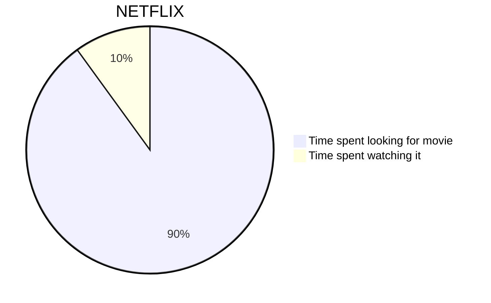
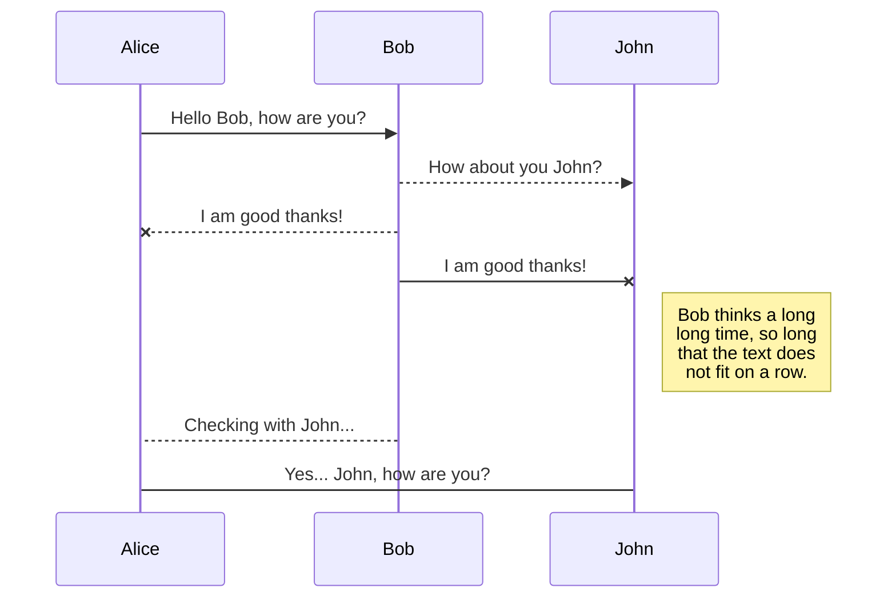
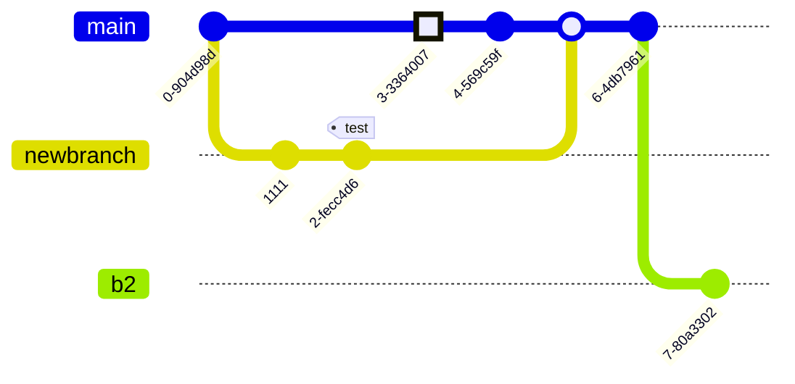

---  
title: Markdown Test MD  
created: 2025-02-20  
updated: 2025-02-25  
tags: ['astro', 'markdown', 'shiki', 'expressive-code', 'mermaid', 'katex' ]  
category: Web  
thumbnail: /files/blog/web/common/assets/code-test4234234.webp  
---  
  
# Code Test  
  
Astro が提供する Shiki で、コードがきれいに表示されるかテストします。  
作成にあたっては、[astro-theme-reimu](https://github.com/D-Sketon/astro-theme-reimu) リポジトリの Markdown 部分を参考にしました。  
追加プラグインは次のとおりです。  
  
- astro-expressive-code  
- expressive-code-color-chips  
- @expressive-code/plugin-collapsible-sections  
- @expressive-code/plugin-line-numbers  
- mermaid  
- rehype-katex  
- remark-math  
  
## Each Language / Code Test  
  
```plain title="example.txt"  
Lorem Ipsum is simply dummy text of the printing and typesetting industry. Lorem Ipsum has been the industry's standard dummy text ever since the 1500s, when an unknown printer took a galley of type and scrambled it to make a type specimen book.  
```  
  
```rust title="example.rs"  
#[derive(Debug)]  
pub enum State {  
    Start,  
    Transient,  
    Closed,  
}  
  
impl From<&'a str> for State {  
    fn from(s: &'a str) -> Self {  
        match s {  
            "start" => State::Start,  
            "closed" => State::Closed,  
            _ => unreachable!(),  
        }  
    }  
}  
```  
  
```json title="example.json"  
[  
  {  
    "title": "apples",  
    "count": [12000, 20000],  
    "description": { "text": "...", "sensitive": false }  
  },  
  {  
    "title": "oranges",  
    "count": [17500, null],  
    "description": { "text": "...", "sensitive": false }  
  }  
]  
```  
  
```python title="example.py"  
@requires_authorization  
def somefunc(param1='', param2=0):  
    r'''A docstring'''  
    if param1 > param2: # interesting  
        print 'Gre\'ater'  
    return (param2 - param1 + 1 + 0b10l) or None  
  
class SomeClass:  
    pass  
  
>>> message = '''interpreter  
... prompt'''  
```  
  
```html title="example.html"  
<!doctype html>  
<title>Title</title>  
  
<style>  
  body {  
    width: 500px;  
  }  
</style>  
  
<script type="application/javascript">  
  function $init() {  
    return true;  
  }  
</script>  
  
<body>  
  <p checked class="title" id="title">Title</p>  
  <!-- here goes the rest of the page -->  
</body>  
```  
  
```javascript title="example.js"  
function $initHighlight(block, cls) {  
  try {  
    if (cls.search(/\bno\-highlight\b/) != -1)  
      return process(block, true, 0x0F) +  
             ` class="${cls}"`;  
  } catch (e) {  
    /* handle exception */  
  }  
  for (var i = 0 / 2; i < classes.length; i++) {  
    if (checkCondition(classes[i]) === undefined)  
      console.log('undefined');  
  }  
  
  return (  
    <div>  
      <web-component>{block}</web-component>  
    </div>  
  )  
}  
  
export $initHighlight;  
```  
  
```ts title="example.ts"  
import fs from 'node:fs';  
import yaml from 'js-yaml';  
  
import { SITE } from './config';  
  
const language = SITE.language.toLowerCase();  
  
const languages = ['en', 'ja', 'zh-cn', 'zh-tw'];  
  
let i18n: Record<string, any> = {};  
  
if (languages.includes(language)) {  
  i18n = yaml.load(  
    fs.readFileSync(`src/languages/${language}.yml`, 'utf8')  
  ) as Record<string, any>;  
}  
else {  
  i18n = yaml.load(fs.readFileSync(`src/languages/en.yml`, 'utf8')) as Record<  
    string,  
    any  
  >;  
}  
  
export function __(key: string): string {  
  const keys = key.split('.');  
  let result = i18n;  
  for (const k of keys) {  
    result = result[k];  
  }  
  return result as unknown as string || key;  
}  
  
export function _p(key: string, params: string | number): string {  
  const keys = key.split('.');  
  let result = i18n;  
  for (const k of keys) {  
    result = result[k];  
  }  
  if (typeof params === 'number' || !Number.isNaN(Number.parseInt(params))) {  
    if (params === 1) {  
      return result?.one?.replace('%d', params) || key;  
    }  
    else {  
      return result?.other?.replace('%d', params) || key;  
    }  
  }  
  else {  
    return result?.replace('%s', params) || key;  
  }  
}  
```  
  
```cpp title="example.cpp"  
#include <iostream>  
  
int main(int argc, char *argv[]) {  
  
  /* An annoying "Hello World" example */  
  for (auto i = 0; i < 0xFFFF; i++)  
    cout << "Hello, World!" << endl;  
  
  char c = '\n';  
  unordered_map <string, vector<string> > m;  
  m["key"] = "\\\\"; // this is an error  
  
  return -2e3 + 12l;  
}  
```  
  
```sql title="example.sql"  
CREATE TABLE "topic" (  
    "id" serial NOT NULL PRIMARY KEY,  
    "forum_id" integer NOT NULL,  
    "subject" varchar(255) NOT NULL  
);  
ALTER TABLE "topic"  
ADD CONSTRAINT forum_id FOREIGN KEY ("forum_id")  
REFERENCES "forum" ("id");  
  
-- Initials  
insert into "topic" ("forum_id", "subject")  
values (2, 'D''artagnian');  
```  
  
```java title="example.java"  
/**  
 * @author John Smith <john.smith@example.com>  
*/  
package l2f.gameserver.model;  
  
public abstract class L2Char extends L2Object {  
  public static final Short ERROR = 0x0001;  
  
  public void moveTo(int x, int y, int z) {  
    _ai = null;  
    log("Should not be called");  
    if (1 > 5) { // wtf!?  
      return;  
    }  
  }  
}  
```  
  
```swift title="example.swift"  
import Foundation  
  
@objc class Person: Entity {  
  var name: String!  
  var age:  Int!  
  
  init(name: String, age: Int) {  
    /* /* ... */ */  
  }  
  
  // Return a descriptive string for this person  
  func description(offset: Int = 0) -> String {  
    return "\(name) is \(age + offset) years old"  
  }  
}  
```  
  
```css title="example.css"  
@font-face {  
  font-family: Chunkfive;  
  src: url('Chunkfive.otf');  
}  
  
body,  
.usertext {  
  color: #f0f0f0;  
  background: #600;  
  font-family: Chunkfive, sans;  
}  
  
@import url(print.css);  
@media print {  
  a[href^='http']::after {  
    content: attr(href);  
  }  
}  
```  
  
```ruby title="example.rb"  
# The Greeter class  
class Greeter  
  def initialize(name)  
    @name = name.capitalize  
  end  
  
  def salute  
    puts "Hello #{@name}!"  
  end  
end  
  
g = Greeter.new("world")  
g.salute  
```  
  
```go title="example.go"  
package main  
  
import "fmt"  
  
func main() {  
    ch := make(chan float64)  
    ch <- 1.0e10    // magic number  
    x, ok := <- ch  
    defer fmt.Println(`exitting now\`)  
    go println(len("hello world!"))  
    return  
}  
```  
  
```bash title="example.sh"  
#!/bin/bash  
  
###### CONFIG  
ACCEPTED_HOSTS="/root/.hag_accepted.conf"  
BE_VERBOSE=false  
  
if [ "$UID" -ne 0 ]  
then  
  echo "Superuser rights required"  
  exit 2  
fi  
  
genApacheConf(){  
  echo -e "# Host ${HOME_DIR}$1/$2 :"  
}  
```  
  
```ini title="example.ini"  
; boilerplate  
[package]  
name = "some_name"  
authors = ["Author"]  
description = "This is \  
a description"  
  
[[lib]]  
name = ${NAME}  
default = True  
auto = no  
counter = 1_000  
```  
  
### Katex Test  
  
$f(n) = \Theta(g(n)) \land g(n) = \Theta(h(n)) \rightarrow f(n) = \Theta(h(n))$  
  
$$  
f^{(i)}(n) =  
\begin{cases}  
n \qquad & i = 1 \\  
f(f^{(i-1)}(n)) \qquad & i>1  
\end{cases}  
$$  
  
$$  
A = \begin{bmatrix}  
A_{11} & A_{12} \\  
A_{21} & A_{22}  
\end{bmatrix}  
,  
B = \begin{bmatrix}  
B_{11} & B_{12} \\  
B_{21} & B_{22}  
\end{bmatrix}  
,  
C = \begin{bmatrix}  
C_{11} & C_{12} \\  
C_{21} & C_{22}  
\end{bmatrix}  
$$  
  
## Mermaid Test  
  

  

  

  