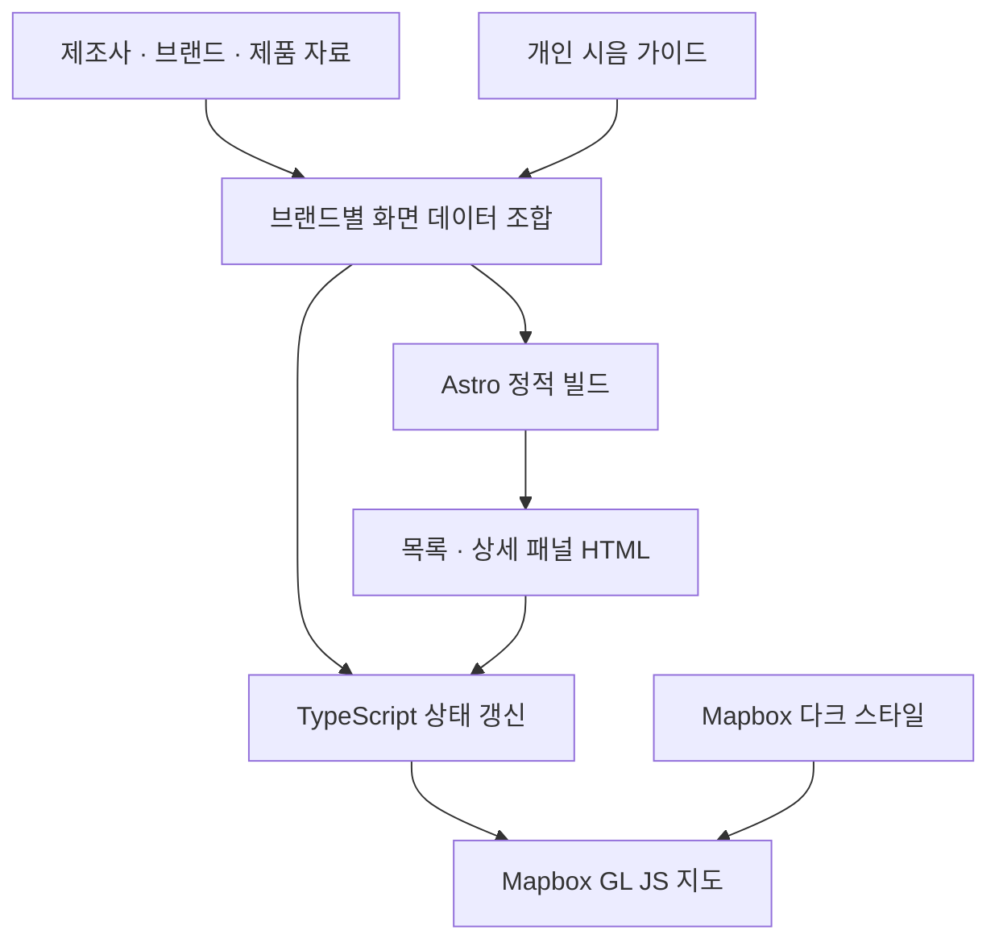
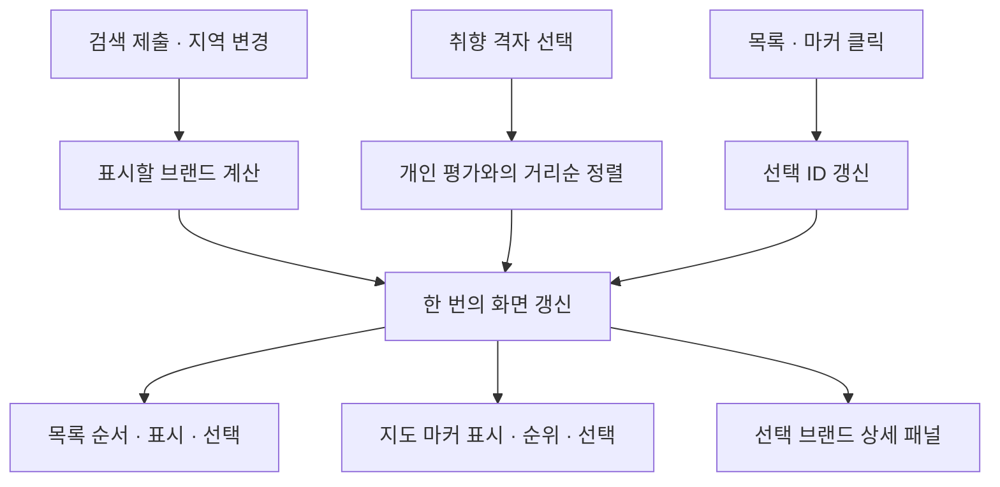

import ProjectInfo from '@/components/Project/ProjectInfo.astro';
import ImageLoader from '@/components/Blog/ImageLoader.astro';
import Mermaid from '@/components/Blog/Mermaid.astro';

<ProjectInfo frontmatter={frontmatter} />

## 설명

2026년 10월 2일 마쓰야마 조자야마 공원에서 열리는 「ほろよいフェスタ 2026」의 참가 19개 브랜드를 정리한 가이드입니다. 양조장 위치, 제품 자료, 개인적인 맛 예상, 우선 시도할 후보와 부스에서 읽을 일본어 문장을 한 페이지에서 확인할 수 있습니다.

처음에는 Claude Design 시안을 Astro 정적 페이지로 옮기는 작업으로 시작했습니다. 이후 지도는 **Mapbox GL JS**로 바꾸고, 브랜드·제조사·제품의 관계, 출처, 검색과 취향별 정렬을 보강했습니다. UI는 한국어·영어·일본어를 지원합니다.

- 사이트: [ehime-horoyoi.jun-devlog.win](https://ehime-horoyoi.jun-devlog.win/)
- 소스: [github.com/JunjaK/ehime-ken-horoyoi](https://github.com/JunjaK/ehime-ken-horoyoi)

행사장에서 휴대폰으로 필요한 정보를 바로 찾는 용도로 만들었습니다. 저녁 행사에 맞춰 화면은 다크 전용으로 구성했습니다.

## 시작점: Claude Design 시안

디자인은 Claude Design에서 먼저 잡았습니다. 결과물은 `.dc.html` 형식으로, `{{ }}` 바인딩과 `sc-for` / `sc-if` 같은 템플릿 문법, `DCLogic` 클래스의 로직이 React 런타임 위에서 동작하는 형태였습니다.

시안의 데이터와 동작을 참고하되 해당 런타임을 서비스에 함께 싣지는 않았습니다. 화면은 Astro에서 정적으로 만들고, 상호작용은 TypeScript로 연결했습니다. 현재 앱의 런타임 의존성은 Astro, Mapbox GL JS, Tailwind CSS이며 React는 사용하지 않습니다.

## 전체 구조

**정적 HTML, 검증한 데이터, 지도와 상태를 갱신하는 스크립트**로 역할을 나눴습니다. 별도 DB나 데이터 조회 API 없이 빌드 결과물과 Mapbox 지도 서비스를 사용하는 구조입니다.

<Mermaid title="데이터에서 정적 화면과 지도까지">



</Mermaid>

| 영역 | 역할 |
| --- | --- |
| `src/data/` | 제조사·브랜드·제품·개인 가이드를 구분하고 화면에서 쓸 데이터로 결합 |
| `src/pages/index.astro` | 목록, 상세 패널, 검색·취향 선택 UI를 빌드 시점에 생성 |
| `src/scripts/map.ts` | Mapbox 초기화, 검색·필터·선택 상태와 화면 동기화 |
| `src/lib/search.ts` | 한글·일본어·제품명을 검색할 수 있도록 문자열 정규화 |
| `src/lib/taste-ranking.ts` | 선택한 취향과 개인 평가값의 거리를 계산해 표시 순서 결정 |
| `src/i18n/` | 한국어·영어·일본어 문구와 언어 전환 |
| `src/styles/global.css` | 공통 색상 토큰과 Mapbox 컨트롤·마커 스타일 |

## 상세 패널 19개를 빌드 시점에 그려두기

원본 시안은 선택한 양조장 하나의 상세를 클라이언트 템플릿으로 그렸습니다. Astro로 옮기면서 참가 브랜드의 상세 패널을 전부 미리 생성하고, 선택할 때는 `hidden`만 바꾸도록 했습니다.

```astro title="src/pages/index.astro — 상세 패널 생성 흐름"
{
  BREWERIES.map((brand) => (
    <article data-id={brand.id} hidden>
      {/* 브랜드·제조사·제품·개인 가이드 */}
    </article>
  ))
}
```

목록도 같은 방식입니다. 클라이언트는 이미 있는 행의 순서와 표시 여부, `aria-current`·`aria-pressed`를 갱신합니다. 작은 고정 데이터셋이므로 선택할 때마다 화면 템플릿을 다시 생성하는 대신, DOM을 유지하면서 상태만 바꾸는 방식을 택했습니다.

다만 정적으로 생성했다는 것이 JavaScript 없이 모든 기능을 쓸 수 있다는 뜻은 아닙니다. 지도와 선택·필터 동작에는 클라이언트 스크립트가 필요하고, 상세 패널도 처음에는 숨겨져 있습니다.

## 제조사·브랜드·제품과 개인 평가를 분리하기

행사 참가 명칭과 실제 양조장, 개별 상품은 서로 다른 정보입니다. 한 제조사가 여러 브랜드를 만들 수도 있고, 평소 판매하는 제품이 이번 행사에서도 제공된다고 단정할 수는 없습니다.

그래서 데이터를 다음과 같이 나눴습니다.

| 데이터 | 담는 내용 |
| --- | --- |
| 제조사 | 이름·지역·주소·대략 좌표, 양조 특징과 출처 |
| 브랜드 | 제조사 ID, 한글·일본어·가나 이름, 별칭, 행사 참가 여부 |
| 제품 | 브랜드 ID, 청주·소주 구분, 확인한 사양·시점·출처, 행사 제공 확인 여부 |
| 개인 가이드 | 예상 맛 점수, 먼저 시도할 후보, 페어링·온도와 일본어 문장 |

`breweries.ts`는 이 원본들을 ID로 연결해 목록과 상세에서 사용할 데이터를 만듭니다. 제조사나 브랜드 연결이 빠지면 화면을 만들기 전에 오류를 내도록 했습니다. 출처도 각 기록에 제목·URL·분류·확인일을 남겨 상세에서 펼쳐 볼 수 있습니다.

맛 프로필과 추천은 **개인 예상값**으로 표시합니다. 제품 자료가 있다고 해서 2026년 행사 제공이나 현재 재고가 확인된 것으로 다루지 않으며, 근거가 다른 사양은 숫자를 임의로 채우지 않고 미확인으로 남깁니다. 지도 좌표도 건물 입구를 가리키는 정밀 좌표가 아니라 지역 대표점임을 표시했습니다.

## Mapbox 지도와 움직이지 않는 마커

현재 지도는 `mapbox-gl`의 `dark-v11` 스타일을 사용합니다. Mapbox 공개 토큰을 빌드 환경에서 받아 초기화하며, 토큰이 없거나 지도 인증·스타일 로딩에 문제가 생기면 상태 문구를 보여줍니다.

브랜드 마커는 `mapboxgl.Marker`에 버튼 요소를 연결해 만듭니다. 버튼이므로 키보드 포커스와 접근성 이름을 부여할 수 있고, 목록과 같은 브랜드 ID를 사용합니다.

```ts title="src/scripts/map.ts"
new mapboxgl.Marker({ element, anchor: 'center' })
  .setLngLat([brewery.lng, brewery.lat])
  .addTo(map);
```

**마커를 선택해도 좌표나 마커 자체의 위치는 바꾸지 않습니다.** 선택은 배경·테두리·색상·앞뒤 순서로 표현합니다. 목록을 누르면 해당 좌표로 지도의 시점을 이동하지만, 지도 마커를 누르면 시점을 다시 옮기는 대신 목록에서 대응하는 행을 찾아 보여줍니다.

밀집한 지역은 확대해서 볼 수 있도록 줌에 따라 마커 크기를 24~36px로 조절합니다. 행사장은 「祭」 마커로 구분하고, 최초 로딩 시 참가 브랜드의 좌표가 들어오도록 지도 범위를 맞춥니다.

초기 버전에는 화면 좌표를 서로 밀어내는 `spreadPoints`가 있었지만, **현재 지도 스크립트는 이 함수를 호출하지 않습니다.** 함수와 자체 점검 코드가 저장소에 남아 있는 것과 실제 지도에서 사용하는 배치 방식은 구분해야 했습니다.

## 검색·지역·취향·선택을 같은 화면에 반영하기

목록과 지도, 상세 패널이 각자 다른 기준으로 상태를 계산하면 선택한 브랜드가 목록에서 사라졌는데 상세는 남는 식의 불일치가 생깁니다. 검색과 지역은 표시 여부를 정하고, 취향은 정렬 순서를 정하며, 선택 ID는 상세와 활성 표시를 정하도록 구분했습니다.

<Mermaid title="입력별 상태와 목록·지도·상세 동기화">



</Mermaid>

### 검색은 제출할 때 적용

검색 입력값과 실제 필터값을 `searchInput`·`appliedQuery`로 나눴습니다. 입력 중에는 목록을 바꾸지 않고 Enter나 검색 버튼을 눌렀을 때 적용하며, 초기화하면 두 값과 입력창을 함께 비웁니다.

검색 대상은 브랜드 이름만이 아닙니다. 제조사·도시·주소, 브랜드의 한글·일본어·가나·별칭, 관련 제품명을 하나의 검색 문자열로 만듭니다. NFKC 정규화, 영문 소문자화, 가타카나의 히라가나 변환을 거치고 공백으로 나눈 검색어가 모두 포함되는지 확인합니다.

### 5×5 취향 선택기로 다시 정렬

세로축은 향, 가로축은 맛의 농도입니다. 한 칸을 고르면 두 축의 개인 평가값과 선택 지점 사이의 제곱 거리를 계산하고, 가까운 브랜드를 앞에 놓습니다. 동점은 ID로 정렬해 순서가 불필요하게 흔들리지 않게 했습니다.

사케 취향표인 점을 고려해 소주 제품만 있는 브랜드에는 별도 가중치를 더합니다. 이것은 전문가의 추천 모델이나 제품의 공식 분석값이 아니라, 제가 현장에서 먼저 살펴볼 순서를 만드는 규칙입니다.

취향 좌표는 `localStorage`에 보관합니다. 목록 순서뿐 아니라 지도 마커와 상세의 순위 숫자·색상도 함께 바꾸되, 브랜드 ID 자체는 유지합니다. 순위가 달라져도 클릭 대상과 제품 연결이 바뀌지 않도록 한 것입니다.

### 터치에서는 클릭으로 선택

현재 선택 상태는 `pinId` 하나로 관리합니다. 같은 목록이나 마커를 다시 누르거나, 상세의 해제 버튼·`Esc`를 누르면 선택을 해제합니다. 호버만으로 상세를 바꾸던 상태는 제거해 터치와 마우스의 동작 차이를 줄였습니다.

지역이나 검색 조건을 바꿀 때는 선택한 브랜드가 새 조건에서도 살아 있는지 검사합니다. 조건에서 빠졌다면 선택을 함께 지워 목록·지도·상세가 같은 대상을 보여주도록 합니다.

## 다크 테마와 다국어

Tailwind v4에 shadcn 계열의 다크 토큰을 정의하고 Card·Badge·Button 등은 Astro 마크업으로 구성했습니다. Select도 기본 HTML 요소를 사용하며, 이 페이지에 React·Radix 런타임을 추가하지 않았습니다.

Mapbox 지도는 `dark-v11`을 쓰고, 지도 라이브러리가 만드는 줌 컨트롤과 attribution도 별도로 스타일링합니다. 마커의 추천 단계 색상은 CSS의 `--color-match-*`를 원본으로 두고 TypeScript가 계산된 값을 읽어 사용합니다. 선택 마커의 글자·배경과 다크 지도 위의 대비도 같은 토큰 안에서 맞췄습니다.

Pretendard와 Pretendard JP를 나눠 쓰며, 일본어 필드에는 `lang="ja"`를 붙입니다. UI 언어는 한국어·영어·일본어를 지원하고, 문구·플레이스홀더·접근성 이름·선택 상태 설명을 언어 전환 시 갱신합니다. 선택한 언어는 저장하고, 저장값이 없으면 브라우저 언어를 기준으로 시작합니다.

<ImageLoader src="/files/playground/ehime-brewery-map-detail.webp" alt="초기 버전의 양조장 상세 패널과 일본어 문장 화면" />

위 화면은 초기 버전의 기록입니다. 현재 소스에는 검색, 취향 격자, 제조사·브랜드·제품 구분과 출처 표시가 추가되어 화면 구성이 달라졌습니다.

## 검증과 배포

화면에서 사용할 데이터가 잘못 이어지지 않도록 자체 점검을 두었습니다. 참가 브랜드 19개와 ID 중복, 에히메 범위를 벗어난 좌표, 맛 점수 범위, 제조사·브랜드·제품 연결, 출처와 다국어 검색 사례를 검사합니다. 과거 마커 배치 함수의 순수 함수 검사도 남아 있습니다.

현재 저장소에는 `node src/check.ts`, `astro check`, 정적 빌드 명령이 있습니다. 빌드 결과는 `dist/`에 생성하고, 운영 구성은 Node 정적 서버와 Docker 이미지로 제공합니다. 별도 DB를 구동하지 않으며, 지도 스타일과 타일은 Mapbox에서 받습니다.

## 정리

- 시안의 데이터와 동작은 출발점으로 삼되, 정적으로 만들 수 있는 화면은 빌드 시점에 생성했습니다.
- 제조사·브랜드·제품 자료와 개인 예상값을 분리해 출처와 미확인 상태를 드러냈습니다.
- 검색·정렬·선택을 다른 상태로 나누고 목록·지도·상세에 함께 반영했습니다.
- 지도는 현재 좌표를 유지하고, 선택은 시각 상태로만 표현합니다.
- 데이터와 순수 계산은 브라우저 밖에서 점검하고, 실제 지도·터치 동작은 별도 화면 확인 대상으로 남겼습니다.
