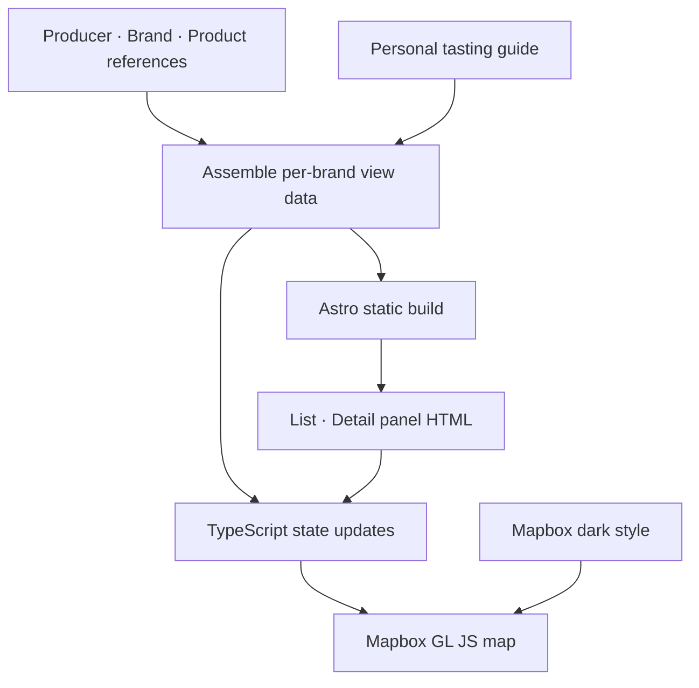
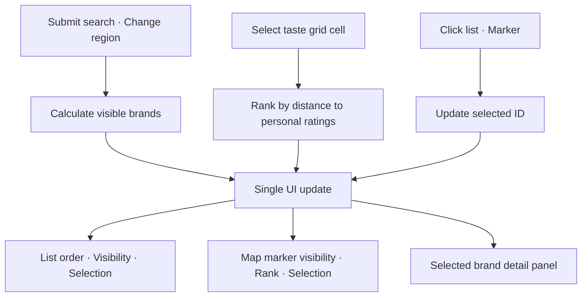

import ProjectInfo from '@/components/Project/ProjectInfo.astro';
import ImageLoader from '@/components/Blog/ImageLoader.astro';
import Mermaid from '@/components/Blog/Mermaid.astro';

<ProjectInfo frontmatter={frontmatter} />

## Description

A guide to the 19 brands participating in 「ほろよいフェスタ 2026」, held on October 2, 2026 at Shiroyama Park in Matsuyama. A single page brings together brewery locations, product references, my personal taste predictions, candidates to try first, and Japanese phrases to read at the booths.

It began as an effort to turn a Claude Design concept into an Astro static page. I later switched the map to **Mapbox GL JS** and expanded relationships between brands, producers, and products, as well as sources, search, and taste-based ranking. The UI supports Korean, English, and Japanese.

- Site: [ehime-horoyoi.jun-devlog.win](https://ehime-horoyoi.jun-devlog.win/)
- Source: [github.com/JunjaK/ehime-ken-horoyoi](https://github.com/JunjaK/ehime-ken-horoyoi)

I built it to find the information I need immediately on my phone at the venue. The screen uses a dark-only theme to suit the evening event.

## Starting point — a Claude Design concept

The design was first developed in Claude Design. Its output was a `.dc.html` file: bindings such as `{{ }}`, template syntax such as `sc-for` / `sc-if`, and logic in a `DCLogic` class running on a React runtime.

I used the concept’s data and behavior as references but did not ship its runtime with the service. Astro renders the static interface, and TypeScript supplies interactions. The current runtime dependencies are Astro, Mapbox GL JS, and Tailwind CSS; React is not used.

## Overall architecture

Responsibilities are divided among **static HTML, validated data, and scripts that update the map and state**. It uses the build output and Mapbox services without a separate database or data-fetching API.

<Mermaid title="From data to static screens and the map">



</Mermaid>

| Area | Role |
| --- | --- |
| `src/data/` | Separate producers, brands, products, and personal guides, then combine them into view data |
| `src/pages/index.astro` | Generate lists, detail panels, and search and taste-selection UI at build time |
| `src/scripts/map.ts` | Initialize Mapbox and synchronize search, filters, selection, and the UI |
| `src/lib/search.ts` | Normalize strings for searching Korean, Japanese, and product names |
| `src/lib/taste-ranking.ts` | Determine display order from distances between selected tastes and personal ratings |
| `src/i18n/` | Korean, English, and Japanese messages and language switching |
| `src/styles/global.css` | Shared color tokens and Mapbox control and marker styles |

## Rendering all 19 detail panels at build time

The original concept used a client template to draw details for one selected brewery. In the Astro version, all participating brand detail panels are generated in advance, and selection only changes `hidden`.

```astro title="src/pages/index.astro — 상세 패널 생성 흐름"
{
  BREWERIES.map((brand) => (
    <article data-id={brand.id} hidden>
      {/* 브랜드·제조사·제품·개인 가이드 */}
    </article>
  ))
}
```

The list works the same way. The client updates the order and visibility of existing rows, along with `aria-current` and `aria-pressed`. For a small fixed dataset, I chose to retain the DOM and change state rather than regenerate UI templates on every selection.

Static generation does not mean every feature works without JavaScript. The map, selection, and filtering require client scripts, and detail panels are initially hidden as well.

## Separating producers, brands, products, and personal ratings

The event participant name, the actual brewery, and individual products are different pieces of information. One producer may make several brands, and a normally available product cannot be assumed to be offered at this event.

I therefore split the data as follows.

| Data | Contents |
| --- | --- |
| Producer | Name, region, address, approximate coordinates, brewing characteristics, and sources |
| Brand | Producer ID, Korean, Japanese, and kana names, aliases, and event participation |
| Product | Brand ID, sake/shochu classification, verified specifications, date and sources, and confirmed event availability |
| Personal guide | Predicted taste scores, first-choice candidates, pairings, temperatures, and Japanese phrases |

`breweries.ts` connects these sources by ID and builds the data used in lists and details. Missing producer or brand links trigger an error before rendering. Each source record also keeps a title, URL, classification, and verification date that can be expanded in the detail panel.

Taste profiles and recommendations are labeled **personal predictions**. Product references do not establish availability at the 2026 event or current stock. Specifications with differing evidence remain unverified instead of having numbers filled in arbitrarily. Map coordinates are also labeled as representative regional points, not precise building entrances.

## Mapbox and markers that stay in place

The current map uses the `dark-v11` style from `mapbox-gl`. It initializes with a public Mapbox token supplied by the build environment, and displays status messages if the token is missing or map authorization or style loading fails.

Brand markers attach button elements to `mapboxgl.Marker`. Buttons can receive keyboard focus and accessible names, and use the same brand IDs as the list.

```ts title="src/scripts/map.ts"
new mapboxgl.Marker({ element, anchor: 'center' })
  .setLngLat([brewery.lng, brewery.lat])
  .addTo(map);
```

**Selecting a marker does not change its coordinates or the marker’s position.** Selection is expressed through background, border, color, and stacking order. Clicking the list moves the map camera to the coordinates, while clicking a map marker reveals the corresponding list row instead of moving the camera again.

Marker sizes adjust from 24 to 36px with zoom to help explore crowded areas. The venue has a 「祭」 marker, and the initial map bounds include the participating brands’ coordinates.

An early version included `spreadPoints`, which pushed screen coordinates apart, but **the current map script does not call it**. The presence of a function and its self-check code in the repository must be distinguished from the placement strategy actually used on the map.

## Reflecting search, region, taste, and selection in one screen

If the list, map, and detail panels calculate state independently, they can diverge—for example, a selected brand disappears from the list but remains in the details. Search and region therefore determine visibility, taste determines sort order, and the selected ID determines details and active indicators.

<Mermaid title="Input state synchronized across list, map, and details">



</Mermaid>

### Applying search on submission

The text being typed and the actual filter value are separated as `searchInput` and `appliedQuery`. Typing does not change the list; Enter or the search button applies the query, while reset clears both values and the input field together.

Search covers more than brand names. Producer, city, address, Korean, Japanese and kana brand names, aliases, and associated product names form one search string. After NFKC normalization, English lowercasing, and katakana-to-hiragana conversion, every space-separated query term must be present.

### Reordering with a 5×5 taste selector

The vertical axis represents aroma, and the horizontal axis represents richness of flavor. Selecting a cell calculates squared distances between that point and the two-axis personal ratings, placing nearby brands first. Ties are broken by ID to prevent unnecessary order changes.

Because the grid expresses sake preferences, brands offering only shochu receive an additional weight. This is neither an expert recommendation model nor an official product analysis; it is a rule for deciding what I want to inspect first at the venue.

Taste coordinates are stored in `localStorage`. List order, map markers, and rank numbers and colors in details change together, while brand IDs remain stable. Changing rank therefore does not change click targets or product relationships.

### Selecting by click on touch devices

Current selection is managed with a single `pinId`. Clicking the same list entry or marker again, the detail panel’s clear button, or `Esc` clears selection. I removed hover-only detail changes to reduce differences between touch and mouse behavior.

When region or search conditions change, the selected brand is checked against the new conditions. If it is no longer included, selection is cleared too, keeping the list, map, and details aligned.

## Dark theme and multiple languages

Tailwind v4 defines shadcn-style dark tokens, while Card, Badge, Button, and similar elements are Astro markup. Select uses a native HTML element too; this page adds no React or Radix runtime.

The Mapbox map uses `dark-v11`, with custom styling for the library’s zoom controls and attribution. Marker recommendation-tier colors originate in CSS `--color-match-*`, and TypeScript reads their computed values. Text, backgrounds, and contrast of selected markers on the dark map are coordinated within the same tokens.

Pretendard and Pretendard JP are used separately, with `lang="ja"` on Japanese fields. The UI supports Korean, English, and Japanese, updating messages, placeholders, accessible names, and selection-state descriptions when languages change. The chosen language is saved; without a saved value, the browser language determines the initial selection.

<ImageLoader src="/files/playground/ehime-brewery-map-detail.webp" alt="Brewery detail panel and Japanese phrases in the early version" />

The screenshot above records an early version. Search, the taste grid, producer/brand/product distinctions, and source displays have since been added, changing the current layout.

## Verification and deployment

Self-checks guard against incorrect links in view data. They cover all 19 participating brands, duplicate IDs, coordinates outside Ehime, taste-score ranges, producer/brand/product relationships, sources, and multilingual search cases. Pure-function checks for the old marker-placement function also remain.

The current repository provides `node src/check.ts`, `astro check`, and static-build commands. Build output is generated in `dist/`, and production is served with a Node static server and Docker image. No separate database runs; map styles and tiles come from Mapbox.

## Recap

- The concept’s data and behavior were a starting point, while screens that could be static were generated at build time.
- Producer, brand, and product references were separated from personal predictions to expose sources and unverified information.
- Search, ranking, and selection were separated into distinct state and reflected across lists, maps, and details.
- The map retains its coordinates; selection is expressed only through visual state.
- Data and pure calculations are checked outside the browser, while actual map and touch behavior remain separate UI-verification targets.
