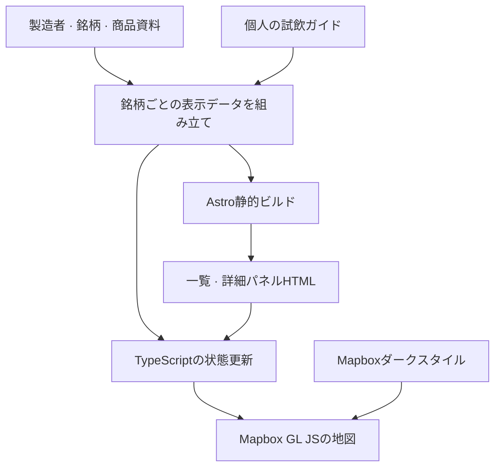
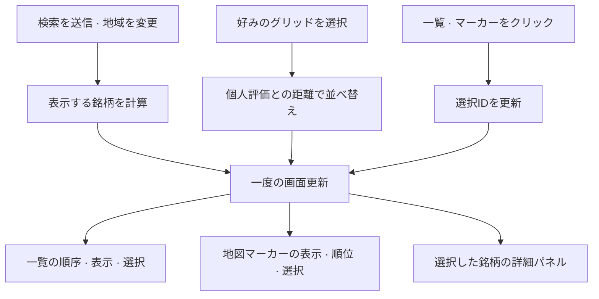

import ProjectInfo from '@/components/Project/ProjectInfo.astro';
import ImageLoader from '@/components/Blog/ImageLoader.astro';
import Mermaid from '@/components/Blog/Mermaid.astro';

<ProjectInfo frontmatter={frontmatter} />

## 説明

2026年10月2日に松山の城山公園で開かれる「ほろよいフェスタ 2026」の参加19銘柄をまとめたガイドです。酒蔵の位置、商品資料、個人的な味の予想、優先して試したい候補、ブースで読む日本語の文を一つのページで確認できます。

最初はClaude Designのデザイン案をAstroの静的ページへ移す作業でした。その後、地図を**Mapbox GL JS**に変え、銘柄・製造者・商品の関係、出典、検索、好みによる並べ替えを充実させました。UIは韓国語・英語・日本語に対応しています。

- サイト: [ehime-horoyoi.jun-devlog.win](https://ehime-horoyoi.jun-devlog.win/)
- ソース: [github.com/JunjaK/ehime-ken-horoyoi](https://github.com/JunjaK/ehime-ken-horoyoi)

会場で必要な情報をスマートフォンですぐ探すために作りました。夜のイベントに合わせ、画面はダークテーマ専用にしています。

## 出発点となったClaude Designのデザイン案

まずClaude Designでデザインを作りました。出力は`.dc.html`形式で、`{{ }}`バインディング、`sc-for` / `sc-if`などのテンプレート構文、`DCLogic`クラスのロジックがReactランタイム上で動く形式でした。

デザイン案のデータや動作は参考にしましたが、そのランタイムはサービスに含めていません。画面はAstroで静的に作り、操作はTypeScriptでつなぎました。現在のアプリのランタイム依存はAstro、Mapbox GL JS、Tailwind CSSで、Reactは使っていません。

## 全体構成

**静的HTML、検証済みデータ、地図と状態を更新するスクリプト**に役割を分けました。別のDBやデータ取得APIを持たず、ビルド成果物とMapboxの地図サービスを使う構成です。

<Mermaid title="データから静的画面と地図まで">



</Mermaid>

| 領域 | 役割 |
| --- | --- |
| `src/data/` | 製造者・銘柄・商品・個人ガイドを区別し、画面用データへ結合 |
| `src/pages/index.astro` | 一覧、詳細パネル、検索・好みの選択UIをビルド時に生成 |
| `src/scripts/map.ts` | Mapboxの初期化、検索・フィルター・選択状態と画面の同期 |
| `src/lib/search.ts` | 韓国語・日本語・商品名を検索できるよう文字列を正規化 |
| `src/lib/taste-ranking.ts` | 選んだ好みと個人評価値との距離から表示順を決定 |
| `src/i18n/` | 韓国語・英語・日本語の文言と言語切り替え |
| `src/styles/global.css` | 共通色トークンとMapboxのコントロール・マーカースタイル |

## 19個の詳細パネルをビルド時に生成する

元のデザイン案は、選択した一つの酒蔵の詳細をクライアントテンプレートで描画していました。Astroへ移す際、参加銘柄の詳細パネルをすべて事前生成し、選択時は`hidden`だけを変えるようにしました。

```astro title="src/pages/index.astro — 상세 패널 생성 흐름"
{
  BREWERIES.map((brand) => (
    <article data-id={brand.id} hidden>
      {/* 브랜드·제조사·제품·개인 가이드 */}
    </article>
  ))
}
```

一覧も同じ方式です。クライアントは既存の行の順番と表示状態、`aria-current`・`aria-pressed`を更新します。小さな固定データなので、選択のたびに画面テンプレートを作り直すのではなく、DOMを保って状態だけを変える方式にしました。

ただし、静的に生成したからといって、JavaScriptなしですべての機能を使えるわけではありません。地図と選択・フィルター操作にはクライアントスクリプトが必要で、詳細パネルも最初は非表示です。

## 製造者・銘柄・商品と個人評価を分ける

イベントの参加名称、実際の酒蔵、個別の商品はそれぞれ異なる情報です。一つの製造者が複数の銘柄を造る場合もあり、普段売っている商品が今回のイベントでも提供されるとは断定できません。

そこで、データを次のように分けました。

| データ | 内容 |
| --- | --- |
| 製造者 | 名前・地域・住所・概略座標、醸造の特徴と出典 |
| 銘柄 | 製造者ID、韓国語・日本語・かなの名前、別名、イベント参加の有無 |
| 商品 | 銘柄ID、清酒・焼酎の区分、確認済み仕様・時点・出典、イベント提供の確認状況 |
| 個人ガイド | 予想の味スコア、先に試す候補、ペアリング・温度と日本語の文 |

`breweries.ts`はこれらの原本をIDで結び、一覧と詳細で使うデータを作ります。製造者や銘柄の接続が欠けていれば、画面生成前にエラーにします。出典も各記録にタイトル・URL・分類・確認日を残し、詳細で展開して確認できます。

味のプロフィールとおすすめは**個人の予想値**として表示します。商品資料があっても、2026年のイベントでの提供や現在の在庫が確認されたとは扱いません。根拠の異なる仕様は数字を勝手に補わず、未確認として残します。地図の座標も、建物の入口を示す精密な位置ではなく地域の代表点であることを示しました。

## Mapboxの地図と動かさないマーカー

現在の地図は`mapbox-gl`の`dark-v11`スタイルを使います。ビルド環境からMapbox公開トークンを受け取って初期化し、トークンがない場合や認証・スタイル読み込みに問題がある場合は状態メッセージを表示します。

銘柄マーカーは、`mapboxgl.Marker`にボタン要素を接続して作ります。ボタンなのでキーボードフォーカスとアクセシブルな名前を付けられ、一覧と同じ銘柄IDを使います。

```ts title="src/scripts/map.ts"
new mapboxgl.Marker({ element, anchor: 'center' })
  .setLngLat([brewery.lng, brewery.lat])
  .addTo(map);
```

**マーカーを選択しても、座標やマーカー自体の位置は変えません。** 選択は背景・枠線・色・重なり順で表現します。一覧を押すと該当座標へ視点を移しますが、地図上のマーカーを押したときは再び視点を動かさず、対応する一覧の行を表示します。

密集地域を拡大して見られるよう、ズームに応じてマーカーサイズを24〜36pxに調整します。会場は「祭」マーカーで区別し、初回読み込みでは参加銘柄の座標が収まるように地図の表示範囲を合わせます。

初期版には画面座標を互いに押し離す`spreadPoints`がありましたが、**現在の地図スクリプトはこの関数を呼びません。** 関数とその自己検査コードがリポジトリに残っていることと、実際の地図で使う配置方式は区別する必要がありました。

## 検索・地域・好み・選択を同じ画面に反映する

一覧・地図・詳細パネルが別々の基準で状態を計算すると、選択した銘柄が一覧から消えたのに詳細は残る、といった不一致が生じます。検索と地域は表示対象、好みは並び順、選択IDは詳細と選択表示を決めるように分けました。

<Mermaid title="入力ごとの状態と一覧・地図・詳細の同期">



</Mermaid>

### 検索は送信時に適用する

入力中の値と実際のフィルター値を`searchInput`・`appliedQuery`に分けました。入力中は一覧を変えず、Enterか検索ボタンで適用し、初期化すると両方の値と入力欄をまとめて空にします。

検索対象は銘柄名だけではありません。製造者・都市・住所、銘柄の韓国語・日本語・かな・別名、関連商品名を一つの検索文字列にまとめます。NFKC正規化、英字の小文字化、カタカナのひらがな変換を行い、空白で区切った検索語がすべて含まれるかを確認します。

### 5×5の好みセレクターで並べ替える

縦軸は香り、横軸は味の濃さです。マスを選ぶと、二軸の個人評価値と選択点との二乗距離を計算し、近い銘柄を前に並べます。同点はIDで並べ、順番が無駄に揺れないようにしました。

日本酒の好み表であることを踏まえ、焼酎だけの銘柄には別の重みを加えます。専門家の推薦モデルや商品の公式分析値ではなく、現地で自分が先に見たい順序を作るためのルールです。

好みの座標は`localStorage`に保存します。一覧の順番だけでなく、地図マーカーや詳細の順位・色も一緒に変えますが、銘柄ID自体は維持します。順位が変わっても、クリック対象や商品との紐づけが変わらないためです。

### タッチではクリックで選択する

現在の選択状態は`pinId`一つで管理します。同じ一覧項目やマーカーを再度押すか、詳細の解除ボタン・`Esc`を押すと選択を解除します。ホバーだけで詳細が変わる動作はなくし、タッチとマウスの違いを減らしました。

地域や検索条件を変えたときは、選択した銘柄が新しい条件でも対象に残るかを確認します。外れた場合は選択も消し、一覧・地図・詳細が同じ対象を表示するようにします。

## ダークテーマと多言語対応

Tailwind v4でshadcn系のダークトークンを定義し、Card・Badge・ButtonなどはAstroのマークアップで構成しました。Selectも標準HTML要素を使い、このページにReact・Radixのランタイムは追加していません。

Mapboxの地図は`dark-v11`を使い、ライブラリが生成するズーム操作やattributionも個別にスタイリングします。マーカーのおすすめ段階の色はCSSの`--color-match-*`を原本とし、TypeScriptが計算済みの値を読みます。選択マーカーの文字・背景と暗い地図上でのコントラストも、同じトークン内で合わせました。

PretendardとPretendard JPを使い分け、日本語のフィールドに`lang="ja"`を付けます。UIは韓国語・英語・日本語に対応し、切り替え時に文言・プレースホルダー・アクセシブルな名前・選択状態の説明を更新します。選んだ言語は保存し、保存値がなければブラウザーの言語を基準に始めます。

<ImageLoader src="/files/playground/ehime-brewery-map-detail.webp" alt="初期版の酒蔵詳細パネルと日本語の文の画面" />

上の画面は初期版の記録です。現在のソースには検索、好みのグリッド、製造者・銘柄・商品の区別、出典表示が加わり、画面構成が変わっています。

## 検証とデプロイ

画面用データの紐づけを誤らないよう、自己検査を用意しました。参加19銘柄、IDの重複、愛媛の範囲外の座標、味スコアの範囲、製造者・銘柄・商品の接続、出典、多言語検索の例を検査します。過去のマーカー配置関数の純粋関数テストも残っています。

現在のリポジトリには`node src/check.ts`、`astro check`、静的ビルドのコマンドがあります。成果物は`dist/`に生成し、運用構成はNodeの静的サーバーとDockerイメージで提供します。別のDBは起動せず、地図スタイルとタイルはMapboxから取得します。

## まとめ

- デザイン案のデータと動作を出発点にしつつ、静的にできる画面はビルド時に生成しました。
- 製造者・銘柄・商品の資料と個人の予想値を分け、出典と未確認の状態を示しました。
- 検索・並べ替え・選択を別の状態に分け、一覧・地図・詳細へ一緒に反映しました。
- 地図の座標を維持し、選択は見た目の状態だけで表現します。
- データと純粋な計算はブラウザー外で確認し、実際の地図とタッチ操作は別の画面確認対象としました。
