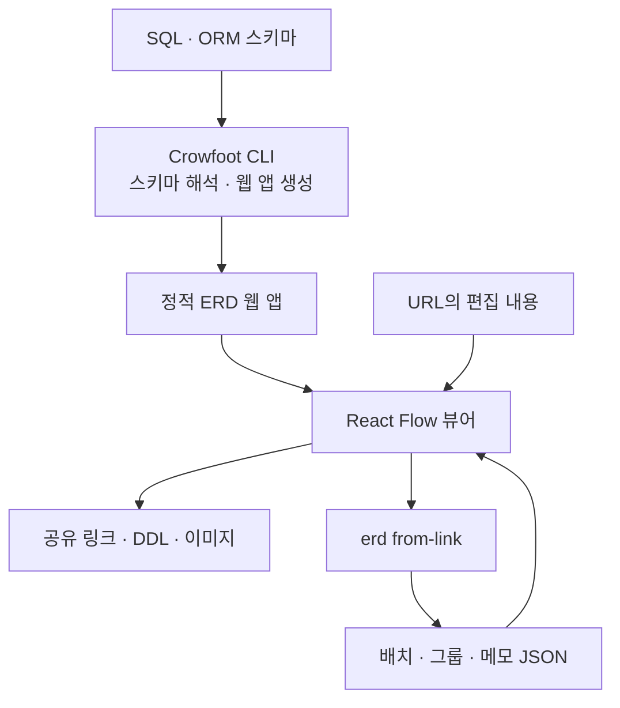
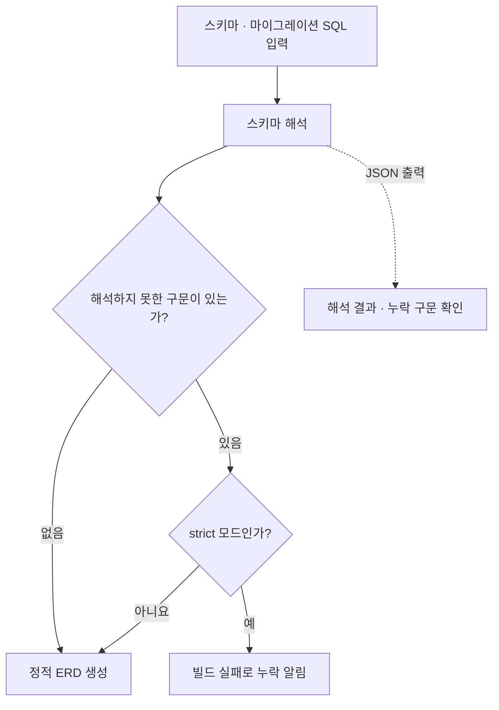

import ProjectInfo from '@/components/Project/ProjectInfo.astro';
import ImageLoader from '@/components/Blog/ImageLoader.astro';
import Mermaid from '@/components/Blog/Mermaid.astro';

<ProjectInfo frontmatter={frontmatter} />

## Intro

> **이 글은 AI를 활용하여 작성했습니다.**

**Crowfoot**은 데이터베이스 스키마 파일에서 ERD를 만들고, 정적 웹 앱으로 공유하는 CLI 도구입니다. [Liam ERD](https://github.com/liam-hq/liam)를 기반으로 만든 포크이며, 원작의 다이어그램 위에 배치 저장·메모·색상·테이블 그룹 등의 기능을 추가했습니다.

ERD는 테이블 사이에 선이 연결되어 있는 것만으로는 읽기 어려울 때가 있습니다. 관련 테이블을 가까이 두고, 도메인별로 묶고, 관계 옆에 설명을 적어야 구조가 눈에 들어옵니다. 그렇게 정리한 배치가 새로고침이나 재생성 뒤에도 이어져야 문서로 쓰기 좋습니다.

실제 프로젝트의 DB 구조를 문서로 공유하려고 Liam ERD를 쓰면서, 옮겨 놓은 테이블 위치가 초기화되는 점과 캔버스에 설명을 남길 수 없는 점이 아쉬웠습니다. MySQL DDL로 내보내는 기능도 필요해 이 부분들부터 추가했습니다.

Crowfoot은 스키마와 함께 **사람이 정리한 배치와 설명을 남기는 것**에 초점을 맞췄습니다. 결과물은 별도 백엔드 없이 HTTP로 제공할 수 있는 정적 사이트입니다.

### 링크

- [Crowfoot 데모](https://crowfoot.jun-devlog.win/)
- [GitHub](https://github.com/Junjak-Personal/crowfoot)
- [npm 패키지](https://www.npmjs.com/package/crowfoot)
- [사용법](https://github.com/Junjak-Personal/crowfoot/blob/master/docs/usage.md)

상단과 본문의 화면은 공개 데모에서 촬영했습니다. 데모에 표시한 스키마는 NiVoca의 레거시 버전으로, 현재 Flutter 앱의 운영 DB와는 구분됩니다.

## 주요 기능

### 다시 열어도 유지되는 배치

테이블을 옮겨 놓으면 그 위치를 URL에 담아 공유할 수 있습니다. 배포된 `layout.json` 위에 URL의 편집 내용을 적용하는 구조이며, `erd from-link` 명령으로 링크의 변경 내용을 배치·그룹·메모 파일에 남길 수 있습니다.

이 파일들을 스키마와 함께 버전 관리하고 생성된 사이트에 제공하면, 다시 빌드한 뒤에도 배치와 설명을 이어 쓸 수 있습니다. 아직 위치를 정하지 않은 테이블은 자동 배치를 사용하므로, 새 테이블이 생길 때마다 전체 배치를 처음부터 만들 필요는 없습니다.

여러 테이블과 메모를 한 번에 선택해 이동하거나 색상을 지정할 수 있습니다. 관련 테이블을 이름 있는 그룹으로 묶으면 캔버스와 사이드바에서도 같은 구분으로 볼 수 있습니다.

확대했을 때는 컬럼을 자세히 보고, 축소하면 테이블 이름이나 그룹 이름 위주로 보이도록 정보량도 조절합니다. 전체 구조에서 관심 있는 테이블까지 같은 캔버스에서 오갈 수 있습니다.

<ImageLoader src="/images/project/crowfoot/02-table-detail.webp" alt="Crowfoot의 도메인별 테이블 목록과 한자 테이블 관계 상세" width={1512} height={872} />

### 다이어그램 위에 남기는 설명

캔버스에 메모를 놓고 크기와 색상, 글자 크기를 조정할 수 있습니다. 테이블과 관계선만으로 드러나지 않는 업무 규칙이나 설계 이유를 가까운 곳에 적어두는 용도입니다.

배치·그룹·메모는 각각 `layout.json`, `groups.json`, `memos.json`에 담아 스키마와 함께 관리할 수 있습니다. 공유한 ERD는 기본적으로 읽기 모드로 열리고, 편집 모드를 켰을 때만 배치와 내용을 바꾸도록 했습니다.

### 브라우저에서 스키마 편집하기

편집 모드에서는 테이블과 컬럼, 제약조건, 인덱스를 수정하고 외래키를 연결할 수 있습니다. 이 변경은 뷰어 안에서 다루는 스키마에 적용하는 것으로, 실제 데이터베이스에 DDL을 실행하는 기능은 아닙니다.

작업한 결과는 DDL이나 이미지로 내보낼 수 있습니다. 원작의 내보내기에 MySQL DDL 출력을 추가해, 구조를 검토하고 다른 형태로 옮기는 작업에도 사용할 수 있도록 했습니다.

<ImageLoader src="/images/project/crowfoot/03-schema-editor.webp" alt="Crowfoot 편집 모드에서 컬럼과 제약조건을 수정하는 화면" width={1512} height={872} />

<ImageLoader src="/images/project/crowfoot/04-export.webp" alt="MySQL과 PostgreSQL DDL, PNG, 배치 파일을 내보내는 Crowfoot 메뉴" width={1512} height={872} />

### CLI로 생성하고 배치하기

PostgreSQL SQL 외에도 Prisma, Rails, Drizzle, tbls 등의 스키마를 입력으로 받을 수 있습니다. 간단한 생성 명령은 다음과 같습니다.

```sh
npx crowfoot erd build --input schema.sql --format postgres --output-dir dist
npx serve dist/
```

여러 마이그레이션 SQL을 순서대로 읽어 스키마의 최종 형태를 구성하는 것도 지원합니다. SQL을 DB에 실행하는 방식이 아니므로 동적 SQL이나 데이터 조건에 따라 달라지는 변경까지 재현하지는 못합니다. 해석하지 못한 내용을 조용히 넘기지 않도록 `--strict` 옵션으로 빌드를 실패시킬 수 있습니다.

`erd plan`과 `erd arrange`는 좌표를 하나하나 지정하는 대신, 테이블을 어떤 그룹으로 묶을지 정한 계획에서 배치 파일을 만드는 기능입니다. AI 에이전트도 그룹과 설명을 제안하고 CLI에 배치를 맡길 수 있도록 구성했습니다.

## 기술 스택

| 영역 | 사용 기술 |
| --- | --- |
| 기반 프로젝트 | Liam ERD, Apache-2.0 |
| 뷰어 | React, TypeScript, React Flow |
| 자동 배치 | ELK.js |
| UI | Radix UI, CSS Modules |
| CLI | Node.js, Commander |
| 빌드 | Vite, pnpm 워크스페이스 |
| 결과물 | 정적 SPA, JSON 배치·그룹·메모 파일 |

## 설계와 구현

### 전체 구조

스키마를 읽어 결과물을 만드는 CLI와, 그 결과물을 탐색·편집하는 브라우저 뷰어를 나눴습니다. 결과물은 정적 웹 앱이므로 별도 백엔드 없이 공유할 수 있습니다.

<Mermaid title="생성 도구와 정적 뷰어의 구성">



</Mermaid>

| 구성 요소 | 맡은 역할 |
| --- | --- |
| CLI | SQL·ORM 스키마를 해석하고 ERD 웹 앱과 관련 파일을 생성 |
| React Flow 뷰어 | 테이블·관계를 표시하고 배치, 메모, 그룹과 스키마를 편집 |
| 배치·그룹·메모 파일 | 스키마 자체와 별도로 사람이 정리한 다이어그램 정보를 보관 |
| URL·내보내기 경로 | 편집 상태를 링크로 공유하거나 CLI로 파일에 반영하고, DDL·이미지 등으로 내보냄 |

### 스키마 해석에서 누락을 드러내는 흐름

<Mermaid title="스키마 해석에서 누락을 드러내는 흐름">



</Mermaid>

### 스키마를 갱신해도 설명은 유지하기

스키마를 만드는 데이터와 화면에서 정리한 정보를 나눠 관리했습니다. 스키마를 새로 읽어도 기존 테이블의 배치와 설명을 다시 적용할 수 있어야, 다이어그램을 한 번 쓰고 버리는 그림 대신 계속 갱신하는 문서로 사용할 수 있기 때문입니다.

최근에는 파싱하지 못한 내용을 드러내는 데도 신경 썼습니다. `--json`으로 해석 결과와 누락된 구문을 확인하고, 입력 파일의 해시·도구 버전·빌드 시각을 결과물에 남깁니다. 보기 좋은 그림이라도 스키마 변경 하나가 조용히 빠지면 문서로 믿기 어렵기 때문에, 자동화에서 이런 누락을 확인할 수 있게 한 것입니다.

또한 포크에서 추가한 기능과 원작의 기능을 구분해 README와 NOTICE에 남겼습니다. Crowfoot은 Liam ERD 전체를 새로 만든 프로젝트가 아니라, 기존 도구를 실제로 쓰면서 필요했던 기능을 더해 별도 이름으로 배포하는 프로젝트입니다.
