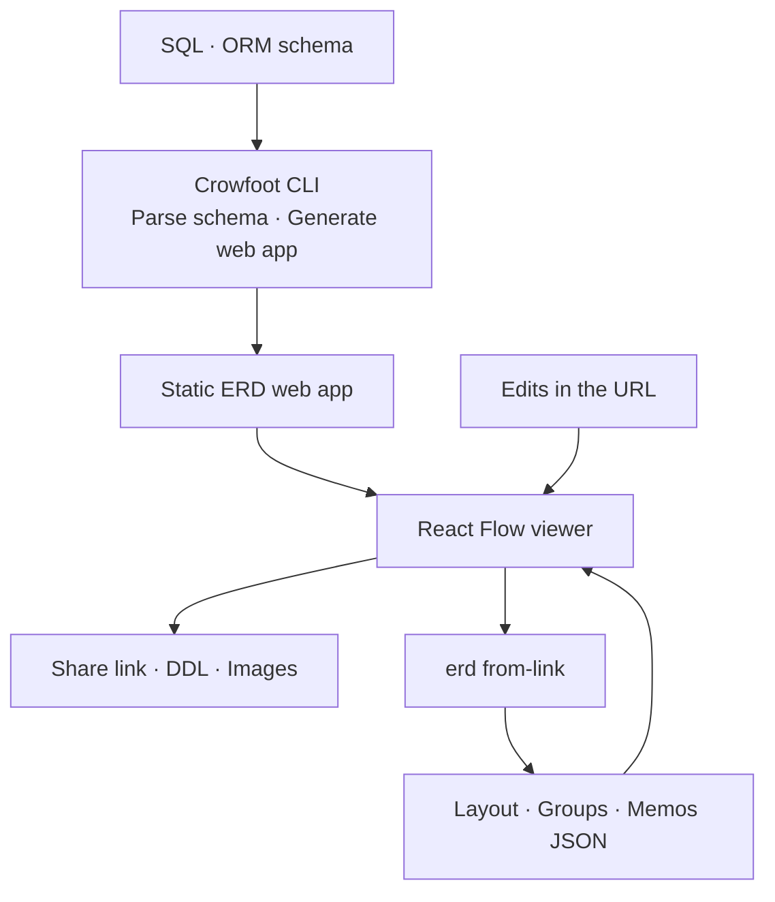
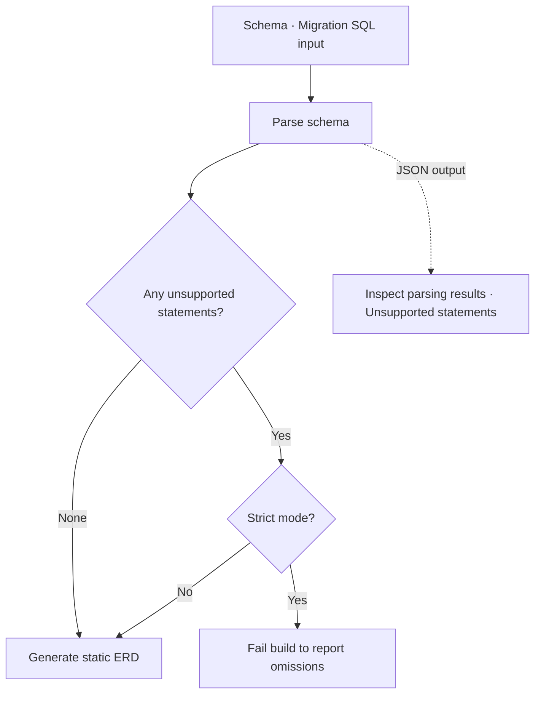

import ProjectInfo from '@/components/Project/ProjectInfo.astro';
import ImageLoader from '@/components/Blog/ImageLoader.astro';
import Mermaid from '@/components/Blog/Mermaid.astro';

<ProjectInfo frontmatter={frontmatter} />

## Intro

> **This article was written with the help of AI.**

**Crowfoot** is a CLI tool that creates ERDs from database schema files and shares them as static web apps. It is a fork based on [Liam ERD](https://github.com/liam-hq/liam), adding saved layouts, notes, colors, and table groups on top of the original diagrams.

An ERD can be difficult to read when it consists only of tables joined by lines. The structure becomes clearer when related tables are placed together, grouped by domain, and annotated beside their relationships. For documentation, that carefully arranged layout also needs to survive refreshes and regeneration.

While using Liam ERD to document a real project’s database structure, I missed the ability to retain moved table positions and leave explanations on the canvas. I also needed MySQL DDL export, so these were the first features I added.

Crowfoot focuses on **preserving human-arranged layouts and explanations** alongside the schema. The output is a static site that can be served over HTTP without a separate backend.

### Links

- [Crowfoot demo](https://crowfoot.jun-devlog.win/)
- [GitHub](https://github.com/Junjak-Personal/crowfoot)
- [npm package](https://www.npmjs.com/package/crowfoot)
- [Usage](https://github.com/Junjak-Personal/crowfoot/blob/master/docs/usage.md)

The screenshots at the top and in this article were taken from the public demo. Its schema belongs to the legacy version of NiVoca, separate from the production database of the current Flutter app.

## Main features

### Layouts that survive reopening

Moved table positions can be included in a URL for sharing. URL edits are applied on top of the deployed `layout.json`, and the `erd from-link` command can persist changes from the link into layout, group, and memo files.

Versioning these files with the schema and serving them with the generated site preserves layouts and explanations after rebuilding. Tables that have not been positioned yet use automatic layout, so new tables do not require arranging everything from scratch.

Multiple tables and notes can be selected together to move or recolor them. Related tables can be put in named groups, which appear consistently on the canvas and in the sidebar.

The amount of detail adapts to zoom: columns are shown up close, while table or group names take priority when zoomed out. The same canvas supports moving between the overall structure and a table of interest.

<ImageLoader src="/images/project/crowfoot/02-table-detail.webp" alt="Crowfoot domain-organized table list and detailed kanji table relationships" width={1512} height={872} />

### Explanations on the diagram

Notes can be placed on the canvas with adjustable size, color, and font size. They provide a nearby place for business rules or design decisions that tables and relationship lines alone cannot explain.

Layouts, groups, and notes can be kept in `layout.json`, `groups.json`, and `memos.json`, respectively, alongside the schema. Shared ERDs open in read mode by default; layouts and content can only be changed after enabling edit mode.

### Editing schemas in the browser

Edit mode supports changes to tables, columns, constraints, and indexes, as well as foreign-key connections. These changes affect the schema within the viewer; they do not execute DDL against a real database.

Results can be exported as DDL or images. I added MySQL DDL output to the original export functionality, making it useful for reviewing structures and moving them to other formats.

<ImageLoader src="/images/project/crowfoot/03-schema-editor.webp" alt="Editing columns and constraints in Crowfoot edit mode" width={1512} height={872} />

<ImageLoader src="/images/project/crowfoot/04-export.webp" alt="Crowfoot export menu for MySQL and PostgreSQL DDL, PNG, and layout files" width={1512} height={872} />

### Generating and arranging with the CLI

Besides PostgreSQL SQL, input formats include Prisma, Rails, Drizzle, and tbls schemas. A simple generation command looks like this.

```sh
npx crowfoot erd build --input schema.sql --format postgres --output-dir dist
npx serve dist/
```

It also supports reading migration SQL files in order to assemble the final schema. Because SQL is not executed against a database, it cannot reproduce dynamic SQL or changes that depend on data conditions. The `--strict` option can fail a build rather than silently skip unsupported statements.

`erd plan` and `erd arrange` generate layout files from a plan describing table groups, rather than assigning every coordinate individually. AI agents can suggest groups and explanations while leaving placement to the CLI.

## Tech stack

| Area | Technologies |
| --- | --- |
| Base project | Liam ERD, Apache-2.0 |
| Viewer | React, TypeScript, React Flow |
| Automatic layout | ELK.js |
| UI | Radix UI, CSS Modules |
| CLI | Node.js, Commander |
| Build | Vite, pnpm workspace |
| Output | Static SPA, JSON layout, group, and memo files |

## Design and implementation

### Overall architecture

The CLI that reads schemas and generates output is separate from the browser viewer used to explore and edit that output. Because the result is a static web app, it can be shared without a separate backend.

<Mermaid title="Generator and static viewer architecture">



</Mermaid>

| Component | Responsibility |
| --- | --- |
| CLI | Parse SQL and ORM schemas and generate the ERD web app and related files |
| React Flow viewer | Display tables and relationships, and edit layouts, memos, groups, and schemas |
| Layout, group, and memo files | Store human-organized diagram information separately from the schema itself |
| URL and export paths | Share editing state through links, persist it to files with the CLI, or export it as DDL, images, and other formats |

### Revealing omissions in schema parsing

<Mermaid title="Revealing omissions in schema parsing">



</Mermaid>

### Keeping explanations when the schema changes

I separated the data used to build the schema from the information arranged in the UI. Existing table layouts and explanations need to be reapplied when a schema is reread so the diagram can become continuously updated documentation rather than a disposable picture.

Recently I also focused on exposing unsupported input. `--json` shows parsing results and skipped statements, while input hashes, tool versions, and build times are recorded in the output. Even a polished diagram is hard to trust as documentation if a schema change disappears silently, so these omissions can be checked in automation.

The README and NOTICE also distinguish features added in the fork from those in the original. Crowfoot is not a rebuild of all of Liam ERD: it adds features I needed while using the existing tool and distributes the result under a separate name.
