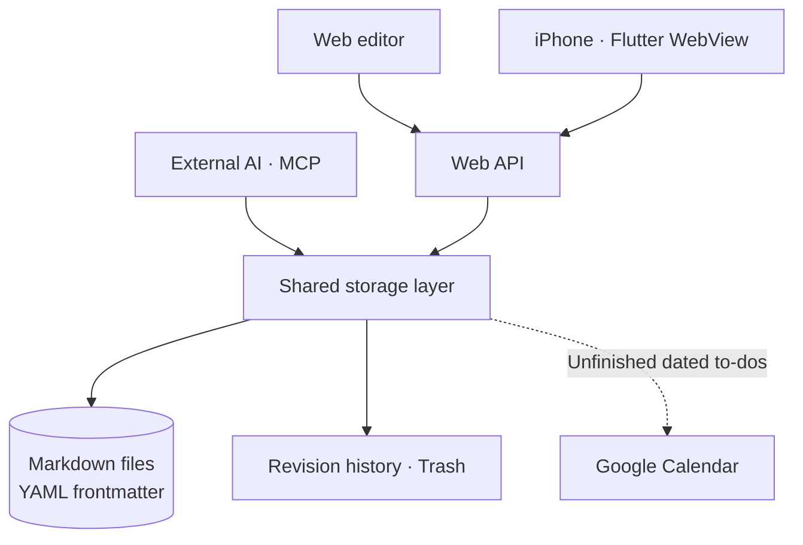
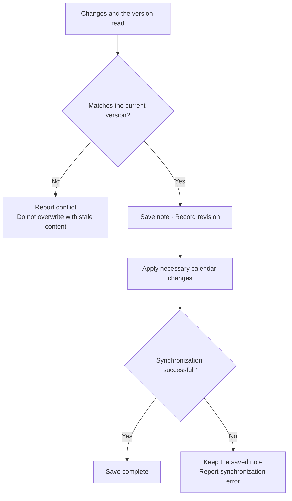

import ProjectInfo from '@/components/Project/ProjectInfo.astro';
import ImageLoader from '@/components/Blog/ImageLoader.astro';
import Mermaid from '@/components/Blog/Mermaid.astro';

<ProjectInfo frontmatter={frontmatter} />

## Intro

> **This article was written with the help of AI.**

**memo** is a note-taking app for my own use. Editing happens in the browser, but the result is saved as Markdown files in a server folder. I use it on the web on PC, and through a Flutter WebView app that opens the same website on iPhone.

The core idea is to keep notes as files while making them easy to open and edit on both phone and PC. Alongside folders for organization and tags for finding notes again, I added to-dos and a calendar so records and tasks can be handled in one place.

It is closer to the notebook I use every day than a collaboration tool for multiple people. Instead of multiple accounts, access is password-protected, and Markdown was chosen as a format I can read and move myself.

### Site links

- [memo](https://memo.jun-devlog.win/) — A personal service available after signing in.

The screenshots at the top and in this article were taken by running the current code locally with **synthetic notes created for this introduction**. No personal notes were used. The calendar screenshot is also a local example with Google Calendar integration disabled.

## Main features

### Edit visually, save as Markdown

The Tiptap-based editor handles text, lists, tables, code blocks, and images. Notes can be organized in a folder tree and found again through title and body search or the tag screen.

Information such as the title, date, and tags is recorded in Markdown frontmatter. Opening a file shows both the body and its note metadata. Deleted notes can be restored from the trash.

### Find, connect, and reuse notes

Recent notes and favorites provide access to frequently used writing, while a heading-based table of contents and collapsible sections help with long documents. Internal links to other notes and backlinks are also supported. On save, these become ordinary Markdown links, so they remain visible when reading the files outside the app.

Reusable documents are kept in 「My templates」. The title, body, and tags are copied, while the new note’s date, to-do state, and public visibility are reset. This is useful for reading notes or travel preparation, where the structure stays similar but the contents change.

<ImageLoader src="/images/project/memo/04-templates.webp" alt="Saving a synthetic reading note as a template and creating a new note" width={1512} height={872} />

### Distinguishing notes, to-dos, and events

A note can be converted into a to-do with a date and priority. To-dos are collected in a dedicated folder, and finished items are managed as completed.

Only **unfinished to-dos with a date** appear in the calendar. Dates on ordinary notes are kept as records and do not become events. Otherwise, every dated note would become an event, mixing records with things that need doing.

Google Calendar integration is one-way through a dedicated calendar. Changing a to-do’s date in memo updates the calendar; completing it or converting it back to a regular note removes the linked event. Existing Google events are not imported into the app.

<ImageLoader src="/images/project/memo/02-todos-priority.webp" alt="The memo list showing dates and priorities for synthetic to-dos" width={1512} height={872} />

<ImageLoader src="/images/project/memo/03-calendar.webp" alt="A local memo calendar showing synthetic to-dos and date-range events" width={1512} height={872} />

### Connecting AI to read and write notes

Through MCP, AI clients can search and read notes or create new notes and to-dos. AI writes go through the same storage logic as the web editor.

Updates to an existing note must include the version that was read. If it has changed elsewhere in the meantime, the save is rejected to prevent AI from overwriting it with outdated content. The delete tool can only move notes to the trash.

### Publishing only the notes you need

Enabling public sharing for a note creates a link that can be read without signing in. This shares just the selected piece of writing rather than all notes. Users control visibility directly in the UI, and AI tools cannot enable it.

## Tech stack

| Area | Technologies |
| --- | --- |
| Web app and server | Nuxt 4, Vue, TypeScript, Nitro |
| UI | Nuxt UI, Tailwind CSS |
| Editor | Tiptap, Shiki |
| Storage | Markdown files, YAML frontmatter |
| iPhone app | Flutter, WebView |
| Calendar | Google Calendar API |
| AI connection | MCP SDK, OAuth |
| Deployment | Docker, GitHub Actions, Cloudflare Tunnel |

## Design and implementation

### Overall architecture

There are several editing interfaces and external integrations, but the rules for saving notes are managed in one place.

<Mermaid title="Multiple input paths, one set of storage rules">

</Mermaid>

| Component | Responsibility |
| --- | --- |
| Nuxt web and Flutter WebView | Read and edit notes in the same web editor; the iPhone app supplements device behavior such as the keyboard and toolbar |
| Web API and MCP | Accept input from people and AI and pass it to the shared storage layer |
| Shared storage layer | Save Markdown and frontmatter, check version conflicts, and manage history and trash |
| Google Calendar integration | Reflect unfinished dated to-dos among saved notes as external events |

Note files remain readable outside the app, while the calendar is a channel for sending only information that represents events. Separating the success of note storage from external synchronization follows this same principle.

### The boundary between note updates and external synchronization

<Mermaid title="The boundary between note updates and external synchronization">

</Mermaid>

### A single path for saving notes

Whether a change comes from the web editor or AI, file storage, conflict detection, trash handling, and calendar updates go through the same storage layer. I focused on keeping the rules consistent as input paths increase.

Mistakes can be checked against the original in revision history and restored. To avoid an unlimited history entry for every autosave, revisions are grouped into five-minute intervals, retaining up to 50 per note from the last 30 days.

Even if a calendar update fails, the note itself is saved and the synchronization error is reported separately. This separation prevents an external-service problem from losing the writing just entered.

### An iPhone app using the same web editor

Rather than implementing the editor again, the iPhone app opens the web version in Flutter WebView. Editing behavior stays on the web, while the toolbar above the keyboard is native. I refined details that matter during actual note-taking: keeping the editor focused when tapping the toolbar, keyboard and safe-area handling, and screen restoration.

For a note-taking app, I think being able to write immediately when an idea comes and find it again later matters more than a long feature list. I keep adding small features to memo based on that flow and my own daily use.
