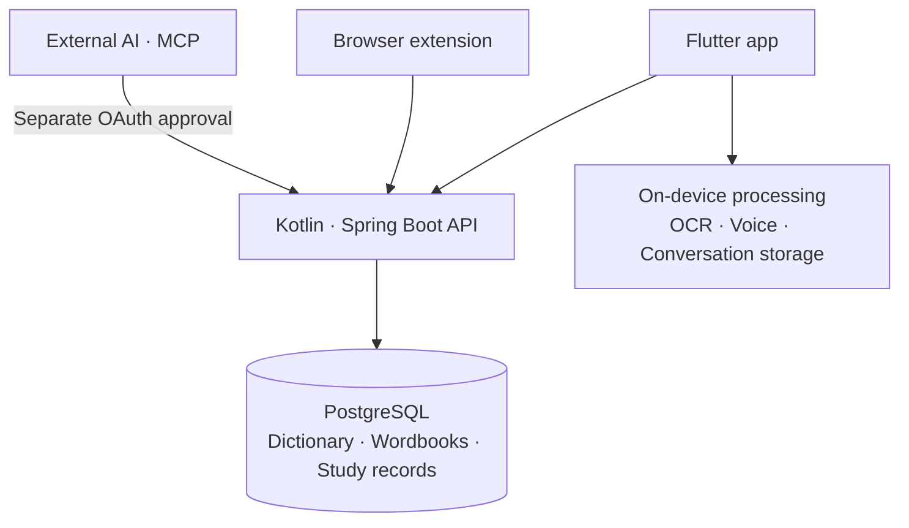
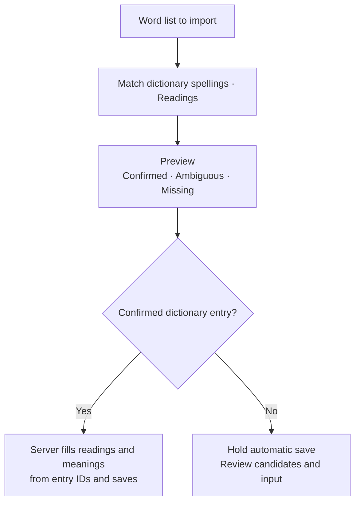

import ProjectInfo from '@/components/Project/ProjectInfo.astro';
import ImageLoader from '@/components/Blog/ImageLoader.astro';
import Mermaid from '@/components/Blog/Mermaid.astro';

<ProjectInfo frontmatter={frontmatter} />

## Intro

> **This article was written with the help of AI.**

**NiVoca** is an app for collecting and reviewing Japanese words. I rebuilt the previously introduced [NiVoca (Legacy)](/project/nivoca-legacy) with Flutter and Kotlin/Spring Boot, and this is the version now available on the App Store.

The original goal was simply to make entering Japanese words more convenient. Switching from a Korean or English keyboard just to enter one Japanese word was cumbersome, so I started with a vocabulary app that converts romaji to kana. Features for collecting words from books or screens through photos and studying saved words were added one by one.

While building the previous version, I also tried features that interact directly with the device, such as on-device AI. I felt the limits of adding these to a web- and WebView-centered structure, so I moved the app to Flutter and built a separate backend. This rebuild aims to connect word entry and study naturally within a mobile app.

## Project screenshots

<figure>
<ImageLoader src="/images/project/nivoca/01-word-add.webp" alt="NiVoca add-word screen with readings and meanings filled from dictionary search" width={960} height={1937} />
<figcaption>Add a dictionary word together with its meaning and reading.</figcaption>
</figure>
<figure>
<ImageLoader src="/images/project/nivoca/02-ocr-results.webp" alt="Selecting Japanese word candidates found through photo recognition in NiVoca" width={960} height={2081} />
<figcaption>Select and save only the words you need from a photo.</figcaption>
</figure>
<figure>
<ImageLoader src="/images/project/nivoca/03-wordbooks.webp" alt="NiVoca personal wordbooks organized by topic" width={960} height={1937} />
<figcaption>Separate wordbooks by the topics you want to study.</figcaption>
</figure>
<figure>
<ImageLoader src="/images/project/nivoca/04-quiz.webp" alt="Reviewing an example sentence on a NiVoca word card and rating recall difficulty" width={960} height={1937} />
<figcaption>Check the word and example, then rate the review difficulty.</figcaption>
</figure>
<figure>
<ImageLoader src="/images/project/nivoca/05-writing.webp" alt="Practicing kanji handwriting with NiVoca stroke-order guides" width={960} height={1937} />
<figcaption>Practice writing by following the stroke-order guide.</figcaption>
</figure>

These are the Flutter app’s dictionary-based word entry, photo recognition, wordbook, quiz, and writing-practice screens. They were captured on a physical device around August 2026, and some UI may differ from the current release.

### Links

- [View NiVoca on the App Store](https://apps.apple.com/kr/app/nivoca/id6769042671)
- [NiVoca introduction site](https://nivoca-landing.jun-devlog.win/)
- [Browser extension guide](https://nivoca-landing.jun-devlog.win/guide/extension/)
- [Previous web and React Native version](/project/nivoca-legacy)

## Main features

### Several ways to collect words

Search the dictionary directly or find words in photos and copied Japanese text to add to wordbooks. Romaji, voice, and handwriting input are supported. Readings and meanings can be checked before saving, while wordbooks and tags organize what to study.

Japanese text from other apps can also arrive through the share sheet or clipboard. Photo OCR uses Apple Vision on iOS and ML Kit on Android, separately from the step that selects word candidates from the recognized text.

Instead of filling every wordbook manually, users can use JLPT-level and shared wordbooks. Word details include example sentences and kanji information, so studying is not limited to memorizing meanings.

### Sharing, subscribing to, or copying wordbooks

Users can publish their own wordbooks and subscribe to or copy others. Alongside default JLPT-level books, this can share collections around travel, food, or current reading. Users can inspect shared wordbooks and choose what they need, beginning study without entering every word themselves.

Subscribed words can also be added to personal wordbooks. Access is managed so shared words do not remain exposed after sharing is disabled or a user is blocked; wordbooks unavailable for the current quiz explain why. Bringing words from other apps through the share menu is a separate flow from sharing wordbooks within the app.

A subscription reads words from the original, while copying brings accessible words into the user’s ownership and links them to a new wordbook. Because subscriptions follow the original’s visibility while personal words are independent, I did not combine them into the same 「Add」 operation. Copying and sharing AI replies are provided separately too.

Word lists can be attached to AI conversations as text files such as CSV or TSV. Reading a file is separate from actually saving words; proposals are reviewed before applying them. Owner-only MCP also lets external AI parse CSV and call import-preview and application tools.

### Studying the words you have collected

Reviews use the FSRS spaced-repetition algorithm. Rating difficulty after a quiz adjusts each word’s review interval. Recall can be checked through word cards, example-sentence blanks, writing from a meaning, and other formats.

Today’s quiz and its AI conversation can continue after reopening the app. Basic study covers hiragana, katakana, and grammar; other features include stroke-order writing practice and audio pronunciation checks.

A recently added listening mode reads words, meanings, and examples in sequence. Playback continues in other apps or with the screen off, with adjustable repeats, speed, and pauses. The voice pack for Korean meanings runs on-device after a one-time download.

### AI assistant

Early Flutter versions experimented with on-device models, but the AI assistant in the current release uses **the user’s own OpenAI or Anthropic (Claude) API key**. Users select a provider in settings and consent to transmission before use; API charges are billed to the account associated with that key.

Users can ask about Japanese, request word additions or edits, or organize wordbooks. Data-changing requests show the proposed changes first and run only after confirmation. Conversations are stored on-device by default, with a latest server copy retained only when users explicitly request a backup. The current offering is also described in the [App Store description and update history](https://apps.apple.com/kr/app/nivoca/id6769042671).

Images, PDFs, and text files can be attached to questions or used to find and organize many words at once. On-device OCR for reading text in photos is separate from sending questions and attachments to the selected AI provider.

<figure>
<ImageLoader src="/images/project/nivoca/ai-photo-words.webp" alt="An actual iPhone screen requesting word additions from a travel-sign photo attached to NiVoca AI" width={960} height={2081} />
<figcaption>An actual app screen requesting words from a photo. AI prepares a pending registration list and explains that saving requires approval.</figcaption>
</figure>
<figure>
<ImageLoader src="/images/project/nivoca/quiz-summary.webp" alt="Quiz results and entry points to listening and AI questions in the real NiVoca iPhone app" width={960} height={2081} />
<figcaption>A quiz result screen I captured myself. It shows reviewed cards, new cards, and response scores, with paths to listening and AI questions.</figcaption>
</figure>

## Connecting to external AI through MCP

In addition to in-app AI chat, I built an MCP connection for handling NiVoca words and study records from the AI tools I normally use. For example, I can ask 「Collect and explain the words I missed in recent quizzes」 or put an organized word list into a new wordbook. **This is currently an operational feature restricted to the developer’s own account**, not a feature publicly available to all users.

The server’s MCP endpoint is `https://n-api.jun-devlog.win/mcp`. When an external client requests OAuth approval, users sign in with their NiVoca account and grant access. App login and MCP tokens are separate, and disconnecting an entry in the connection list revokes its access. Refresh tokens rotate on use; reusing a replaced token revokes the connection.

There are currently 13 tools, broadly grouped into the following tasks.

| Task | Example use |
| --- | --- |
| Quiz history and mistakes | Read study dates and question records to explain commonly missed expressions again |
| Personal words and wordbooks | Search collected words and books to decide what to study |
| Batch dictionary search | Check readings and meanings for several words together |
| Add words and create wordbooks | Put confirmed dictionary entries into a wordbook |
| Import preview and application | Separate confirmed, ambiguous, and missing words before saving confirmed entries only |
| Request missing words | Pass words absent from the dictionary to the content-enrichment path |

When adding words, AI-supplied meanings are not stored as-is: **the server fills readings and meanings from dictionary entry IDs.** Words with several candidates remain ambiguous during import. Preview and application are separate to avoid writing AI guesses straight into a personal wordbook.

There is a record of an actual Claude Code connection to the production server that retrieved quiz history and mistakes. Other clients and write operations have different verification coverage, so I do not present them all as verified. The in-app BYOK assistant and MCP also have different roles: the former calls AI providers from the app, while the latter lets external AI call limited NiVoca tools.

Mistake queries use the original correct answer, selected option, and handwriting-recognition result rather than guessing from ratings alone. Initially, incorrect writing answers were stored as 「Hard」 and omitted from general mistake counts; this was changed to use the saved correctness result. Older records without judgment data remain unknown.

## Collecting words while reading in Safari

### Searching within pages and adding yomigana

The separately developed **Safari Web Extension** lets users select Japanese text on the page they are reading to see meanings and yomigana. The app’s Safari extension target is connected to shared browser-extension sources, also used in desktop Chromium browsers. This is separate from the existing share-menu extension.

It can be enabled manually on a page or set to run automatically on sites where access is allowed. To add yomigana to the body, choose a difficulty level and press 「Apply to current screen」. Input fields, code, and other areas that should not be touched are excluded, and application is limited to part of the currently visible body.

Connecting the extension to a NiVoca account requires checking the connection code and account in the app and approving it. Accounts created with Google or Apple do not need a new password for the extension. The text sent by selection search is distinguished from text sent for body yomigana. Describing this as automatic background collection of an entire page would misrepresent its behavior.

Safari uses Native Messaging through a native bridge, with connection state and sessions managed in Keychain. App authentication cookies are not exposed to page JavaScript, and the bridge is restricted to specific servers and paths. UI sources and Chromium service-worker transport are shared where appropriate, while authentication and network boundaries remain browser-specific.

<figure>
<ImageLoader src="/images/project/nivoca/safari-reader.webp" alt="NiVoca extension card showing the meaning and reading of Japanese selected in iPhone Safari" width={960} height={2081} />
<figcaption>An actual screen selecting 「以下」 on a webpage, checking its meaning and reading, and adding it to a wordbook.</figcaption>
</figure>
<figure>
<ImageLoader src="/images/project/nivoca/safari-settings.webp" alt="Automatic-use and yomigana-difficulty settings in the NiVoca Safari extension" width={960} height={2081} />
<figcaption>Configure automatic use on websites and the scope of displayed yomigana.</figcaption>
</figure>

These are debug captures from installing and testing the extension in development on a device. They must be distinguished from the public iOS app’s feature list. Installation, account connection, search, and transmission scope are also documented in the [browser extension guide](https://nivoca-landing.jun-devlog.win/guide/extension/).

### Importing through other apps’ share menus

The existing iOS Share and Action extensions pass selected text or photos to NiVoca. Single words lead to dictionary search, longer Japanese text to word-candidate extraction, and photos to image recognition. Unlike the Web Extension that assists reading within Safari, these bring content found in other apps into the vocabulary app.

## Mate — a game extending the rewards of learning, in development

I am also developing a game feature called **Mate**, so memorizing words contributes to character growth as well as review statistics. It is an attempt to sustain motivation to study, not a finished game currently available on the App Store.

The initial pet concept evolved toward growing and customizing humanoid characters. Learning earns experience and growth resources, which lead into exploration and collecting equipment and cards. Rather than a minigame that replaces study, the structure uses learning results to prepare the next exploration.

Exploration involves choosing rooms such as battles, shops, and unknown events. In battle, players decide the order and combinations of cards in hand. Planning combos around card costs and the enemy’s next move provides something to do with characters after obtaining and growing them.

Combat combines cards with dice values. Effects depend on the value of the slot holding a card, and players choose the order of defense, marks, spells, and finishers. Before executing, they can inspect expected damage and where enemy attacks interrupt; confirming the combo then plays out the result. Long-term learning growth is separated from the combinations built during an exploration, so accumulated study stats alone do not decide every battle.

<figure>
<ImageLoader src="/images/project/nivoca/mate-home-development.webp" alt="Character, study experience, and growth stats in NiVoca Mate under development" width={780} height={1688} />
<figcaption>A development render with fixed example data showing study experience and growth stats.</figcaption>
</figure>
<figure>
<ImageLoader src="/images/project/nivoca/mate-battle-iphone.webp" alt="An actual capture of Moon Ruins combat and combo preparation in NiVoca Mate under development" width={960} height={2081} />
<figcaption>An actual iPhone combat screen selected from additional debug material.</figcaption>
</figure>
<figure>
<ImageLoader src="/images/project/nivoca/mate-route-iphone.webp" alt="An actual capture of exploration routes and room selection in NiVoca Mate under development" width={960} height={2081} />
<figcaption>The development app’s exploration map showing visited rooms and the next route.</figcaption>
</figure>

The first image was rendered with fixed example data; the other two are captures I took of the development app. The exact builds used for those captures have not been verified, and the displayed values and balance are not release specifications. Work is ongoing to refine characters, battles, and exploration by aligning actual Flutter screens with pixel-art assets.

The implementation is separated into a Flutter feature package named `mate_feature`. Flame handles character scenes, while Flutter widgets and CustomPainter handle screens and battle UI. The server determines exploration progress and rewards; learning-completion requests use a fixed learning list and request identifiers to prevent duplicate rewards on retries. Interrupted listening or TTS failures are distinguished from successful completion.

As of November 4, 2026, there are records of stage integration and test-app installation and launch. Full exploration playtesting on physical devices, fun and balance checks, and the final growth policy remain under review; App Store release is separate.

## How the datasets were obtained

Building the vocabulary UI and filling it with usable dictionary entries, meanings, and examples were separate tasks. NiVoca combines **a base dictionary from publicly available external data**, **AI-translated and enriched content**, and **content written or reviewed by me**. Presenting it as either an entirely original dictionary or entirely AI-generated data would be inaccurate.

| Material | Source and use in the app |
| --- | --- |
| Japanese dictionary | Import [JMdict/EDRDG](https://www.edrdg.org/wiki/JMdict-EDICT_Dictionary_Project.html) data in [jmdict-simplified](https://github.com/scriptin/jmdict-simplified) JSON format for spellings, readings, parts of speech, and meanings |
| Search enrichment | Check and cache Jisho search results, verifying matching spellings and readings even for the same word |
| Default JLPT wordbooks | Import JLPT lists originating from Tanos to organize basic words and wordbooks by level |
| Kanji | Build kanji information such as on/kun readings and stroke counts from [KANJIDIC2/EDRDG](https://www.edrdg.org/wiki/KANJIDIC_Project.html) |
| Stroke order | Use [KanjiVG](https://kanjivg.tagaini.net/) SVGs and stroke sequences for kana/kanji guides and writing practice |
| Grammar | Organize grammar entries from [Hanabira’s public Japanese content](https://github.com/tristcoil/hanabira.org-japanese-content) and supplement Korean explanations |
| Japanese history and culture vocabulary | Curate topics after cross-checking spelling and reading evidence in Jisho/JMdict and Japanese Wikipedia |
| Korean meanings and examples | Translate and enrich source meanings, generate study examples with AI, and combine personally written material with reviews and corrections |

### Normalization and enrichment were still needed after import

Importing one dictionary word does not immediately create a complete study card. Different readings of the same spelling need separation, parts of speech and JLPT levels need alignment, and Korean meanings and examples need filling. Collapsing entries with several readings or meanings into one may simplify searching but make study data inaccurate.

Existing dictionary entries are reused, while missing content goes through separate generation and enrichment paths. AI-created content is tracked separately from source material. For topic-specific wordbooks too, word lists are matched against dictionary entries first, and enrichment runs only where new entries are needed.

Search first checks existing database entries, then finds exact matching spellings and readings on Jisho where necessary before AI enrichment. Network calls and storage transactions are separated to avoid holding database locks or connections while waiting for external responses.

There is more than one path for filling examples: agent routines for empty entries, large Claude API batches, and asynchronous server enrichment run separately with source tracking. Automatic enrichment does not overwrite filled content and checks duplicate work, budgets, and retry conditions. Report-driven corrections to existing content are separate from these addition paths.

### Continually adding examples and topic-based wordbooks

Work records from November 1, 2026 show 11,630 new example rows and 2,138 corrected existing examples. On November 2, wordbooks with 725 Japanese-history and 255 Japanese-culture words were added. These figures describe those specific operations, not the current size of the whole dictionary.

The ability to generate in bulk with AI did not automatically produce accurate study material. Japanese examples and translations, readings, and natural usage all need checking; incorrect content continues to be revisited through reports and separate correction work.

Example batches include meanings, parts of speech, and homograph information, with instructions to skip uncertain entries. After generation, checks cover headword inclusion, reading characters, translations, duplicates, and length. Existing-example corrections separate error-candidate detection from an additional review stage. Words such as 「心中」, whose identical spelling has different readings and meanings, also require checking that the sentence fits the intended sense.

### Viewing data sources in the app

External data sources and code-library sources are managed separately. 「Settings → About → Data sources」 lists the origins and usage conditions of dictionary, kanji, JLPT, and grammar data. I record sources per dataset rather than assuming publicly hosted code and content have identical terms.

## Design

The app, browser extension, and external AI handle the same words and study data, but device features and data-changing permissions are separated according to each path’s role.

<Mermaid title="Roles of the app, server, and external connections">

</Mermaid>

| Component | Responsibility | Processing and storage policy |
| --- | --- | --- |
| Flutter app | Word entry and review screens; device features such as OCR and voice | OCR and downloaded voice models run on-device; AI conversations are stored on-device by default |
| Kotlin/Spring Boot server | Dictionary search and wordbook/study-record management | Words and study records are stored in PostgreSQL; readings and meanings are determined from dictionary entries on registration |
| Browser extension | Search and add words on the page being read | Share common UI sources while separating Safari’s native bridge from Chromium authentication and transport |
| MCP connection | Queries and change requests from external AI clients | Use OAuth tokens separate from app login and distinguish import preview from actual storage |

Processing locations reflect whether a feature should run directly on the device or whether data needs consistent rules across multiple entry points. Photo text recognition and voice playback stay close to the app, while the server manages dictionary and study-record consistency.

AI suggestions follow the same separation. Proposals for finding or organizing words are distinct from actual data changes, and waiting for external services is separated from database transactions. This keeps saved study data governed by the same rules as app, extension, and AI integrations grow.

### Importing word lists with AI

<Mermaid title="Importing word lists with AI">

</Mermaid>

## Tech stack

| Area | Technologies |
| --- | --- |
| Mobile app | Flutter, Dart |
| App architecture | MVVM, Repository, Riverpod, go_router |
| UI | Custom ThemeData/ThemeExtension-based theme, Widgetbook |
| Backend | Kotlin, Spring Boot, PostgreSQL |
| Review | FSRS spaced repetition |
| MCP | MCP Java SDK, Streamable HTTP, OAuth·PKCE |
| Browser extension | Shared TypeScript source, Safari Web Extension/Native Messaging, Chromium Manifest V3 |
| Game in development | Flutter feature package, Flame, CustomPainter, Kotlin exploration/combat engine |
| OCR and voice | Apple Vision/ML Kit, OS TTS/VOICEVOX/Supertonic, Dart FFI |
| Introduction site | Astro |
| Server operations | Docker, GitHub Actions, Cloudflare Tunnel |

Instead of directly replacing web component libraries, the Flutter UI builds app colors, typography, and components on ThemeData and ThemeExtension. Shared UI is reviewed separately in Widgetbook.

The app, backend, and introduction site each have their own repository, connected through submodules in a monorepo. Operations distinguish app-screen changes from server work on dictionary and learning data.

## Lessons from operating the app

Maintaining dictionary and question accuracy has been as important as adding features. Awkward meanings or examples directly affect learning, and a distractor too similar to the correct answer makes a fill-in-the-blank question feel unsatisfactory even after solving it.

### Reducing questions that seem to have two answers

Fill-in-the-blank questions were adjusted to exclude distractors from the same semantic field as the answer. If enough suitable options cannot be generated, the format switches to a word card rather than forcing a multiple-choice question. The word stays in the study set while only the problematic question format changes.

### Separating device features from server data

OCR and downloaded voice models run on-device, but words and study records are stored on the server, and AI questions go to the selected provider. Processing locations and storage lifetimes differ by feature, so I do not treat the entire app as a fully offline service. Local conversation storage and manual backups follow this distinction too.

Voice responsibilities are split among Japanese OS TTS/VOICEVOX and Korean OS voices/Supertonic. To add the Korean voice pack without another ONNX runtime, I reused the existing VOICEVOX-side runtime’s C API through Dart FFI to reduce duplication.

### Avoiding duplicate reviews when save responses are interrupted

In a follow-up development version, review requests carry stable identifiers, and requests whose outcomes are unknown stay in a per-account pending queue. Retrying checks the original request instead of creating another review, preventing FSRS state from advancing twice. Correcting an accidentally selected rating uses a separate path. This implementation follows, and is distinct from, public iOS version 1.7.0.

### Keeping a path for correcting errors

Incorrect content can be reported from dictionary results, quiz answer checks, and kanji information as well as word details. Reports distinguish meanings, examples, kun/on readings, and yomigana; only verified corrections are applied. Changing the generation model does not automatically fix existing data, so reviewing stored content remains necessary.

What began as a way to make word entry easier has become a project I refine through personal use across the entire process: encountering words, collecting them, sharing them, and studying them again.
