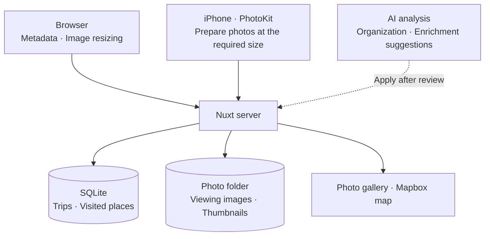
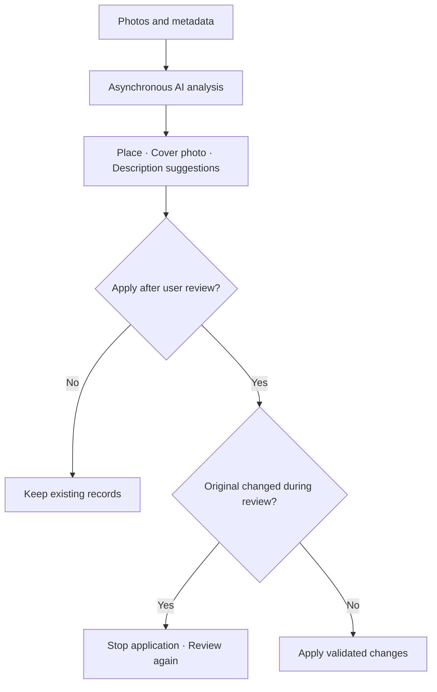

import ProjectInfo from '@/components/Project/ProjectInfo.astro';
import ImageLoader from '@/components/Blog/ImageLoader.astro';
import Mermaid from '@/components/Blog/Mermaid.astro';

<ProjectInfo frontmatter={frontmatter} />

## Intro

> **This article was written with the help of AI.**

**pic·blog** is my personal travel record combining photos, maps, and short stories. GPS coordinates and capture times in photo EXIF data generate visited places and routes, to which place names and writing can be added.

Browsing travel photos chronologically tells me what I saw, but I still have to recall where they were taken and the order in which I visited. pic·blog uses information already present in photos to let me revisit a trip.

Photos go up first to form the outline of a record, with stories added later instead of writing a long article first. Visitors enter directly through a public link; only editing is password-protected. Rather than managing multiple user accounts, I focused on what I need to record and share my travels.

### Site links

- [pic·blog](https://pic-blog.jun-devlog.win/)
- [GitHub](https://github.com/Junjak-Personal/pic-blog)

The screenshots at the top and in this article were taken from real, publicly available travel records in production. The mobile screenshots show the responsive website.

## Main features

### Turning photos into visited places

The browser reads photo locations and capture times, then creates points using distance, shooting order, travel day, and time gaps together. It distinguishes visits made on a different day or after a long gap even at the same location. Each point can have a name, tags, and body text to describe a scene from the trip.

Once a point’s coordinates are set, adding more photos does not move it automatically. Regrouping requires changing the radius in the editor. If this would remove existing descriptions, the affected items are shown for confirmation first.

### A map connected in shooting order

The map connects coordinates in the order the photos were taken. Connecting only representative coordinates for each place would erase movement within the same location, so routes and distances are calculated using each individual photo’s coordinates.

Photos with unknown capture times are excluded from the route. The displayed distance joins coordinates between photos, so it differs from road distance or a continuous GPS track. It is intended to show the flow of a journey preserved in photos.

<ImageLoader src="/images/project/pic-blog/02-route-desktop.webp" alt="Daily photo points and routes in shooting order for a Shizuoka–Izu trip" width={1272} height={874} />

### Recording on mobile and sharing by link

Photos can be selected and place-specific content edited on a phone. Visitors can explore photos and maps without signing in, and can also add the PWA to their home screen.

The layout puts photos first, with the map and stories beside them to add context. I focused on keeping both uploading photos and enjoying a trip’s record smooth on a small screen.

<ImageLoader src="/images/project/pic-blog/03-point-story-desktop.webp" alt="Selecting a visited place opens its photos and story alongside the map" width={1272} height={874} />

<ImageLoader src="/images/project/pic-blog/05-point-mobile.webp" alt="A place description and travel photos at phone width" width={390} height={844} class="mx-auto max-w-sm" />

### Organizing photos and enriching records with AI

Recently I added Claude-based features that analyze photos and metadata. Organization mode regroups photos and suggests titles, while enrichment mode retains existing points and proposes representative photos, short descriptions, and place-name candidates. The description in the place-detail screenshot above is an actual enrichment result.

Suggestions are reviewed before applying. Place names remain candidates with supporting photos and do not automatically overwrite existing titles. User writing and photo membership are protected, and application is blocked if the originals changed during review. Changes can also be undone if the state at application time is still intact.

For large collections, up to 1,000 photos are analyzed asynchronously across multiple requests. The server checks photo and point IDs returned by AI, including missing and duplicate photos.

MCP also lets external AI clients read travel records and update a limited set of fields. This uses OAuth approval separately from the password used for web editing.

## Tech stack

| Area | Technologies |
| --- | --- |
| Framework | Nuxt 4, Vue, TypeScript |
| UI | Reka UI, CSS tokens, scoped CSS |
| Map | Mapbox GL JS |
| Photo metadata | exifr |
| iPhone app | Flutter WebView, PhotoKit integration |
| Storage | SQLite, better-sqlite3, local files |
| Authentication | nuxt-auth-utils, password-based editing permissions |
| Photo AI and external integration | Anthropic Claude, MCP, OAuth |
| Verification | Vitest, Playwright |
| Deployment | Docker, GitHub Actions, Cloudflare Tunnel |

## Design and implementation

### Overall architecture

Photo preparation, travel-record storage, and the viewing interface are separate. Pre-upload preparation runs on the client so the personal server does not have to perform heavy image conversions.

<Mermaid title="Photo preparation, storage, and viewing architecture">

</Mermaid>

| Component | Responsibility |
| --- | --- |
| Browser and iPhone app | Select photos, inspect metadata, and prepare upload images. iPhone obtains photos at the required size through PhotoKit |
| Nuxt server | Save trip and visited-place information in SQLite and keep processed photos as files |
| Map and gallery | Show places, photos, and movement together using GPS coordinates and shooting order |
| AI analysis path | Suggest photo organization and content enrichment asynchronously, then apply changes after review and validation |

I kept storage small enough to run with SQLite and a photo folder. AI analysis does not overwrite existing records directly: a review step between suggestion and application protects the travel records I have organized myself.

### Applying AI suggestions to travel records

<Mermaid title="Applying AI suggestions to travel records">

</Mermaid>

### Processing images in the browser

On the web, photos are resized in the browser before being sent to the server. It creates viewing images up to 2,048px on the long edge and 400px thumbnails; the server does not keep separate originals.

Even when uploading multiple photos, processing happens one at a time with memory released after each. Because the server does not need to convert images, it can retain a simple receive-and-save-to-file structure.

I also built an iPhone app using Flutter WebView. PhotoKit reduces the wait caused by converting large images during web photo selection on iOS. It reads only the necessary metadata and obtains images at the required size before handing them to the web upload flow. Photo-grouping rules and editing logic are shared with the web.

### A structure that is easy to manage on a small server

Data is stored in a SQLite file and photos in server folders. There is no separate external database or object storage: operations revolve around the app process and its data folders.

I reduced operational components to match the scale of a personal travel record. The data directory is separated so the database and photos survive container replacement.

With pic·blog, recording can begin simply by selecting and uploading photos. The focus is on finding those photos again on a map and adding the stories needed to organize a trip.
