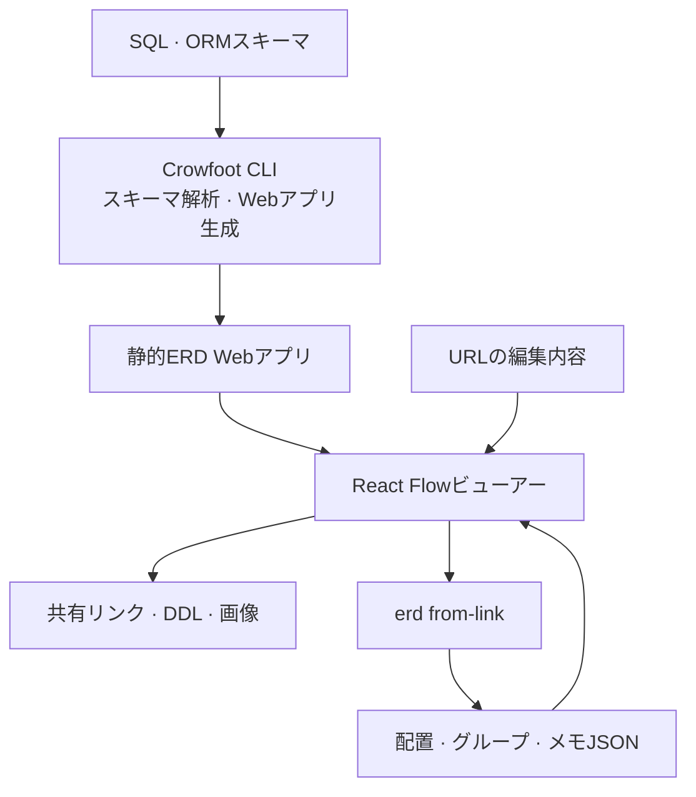
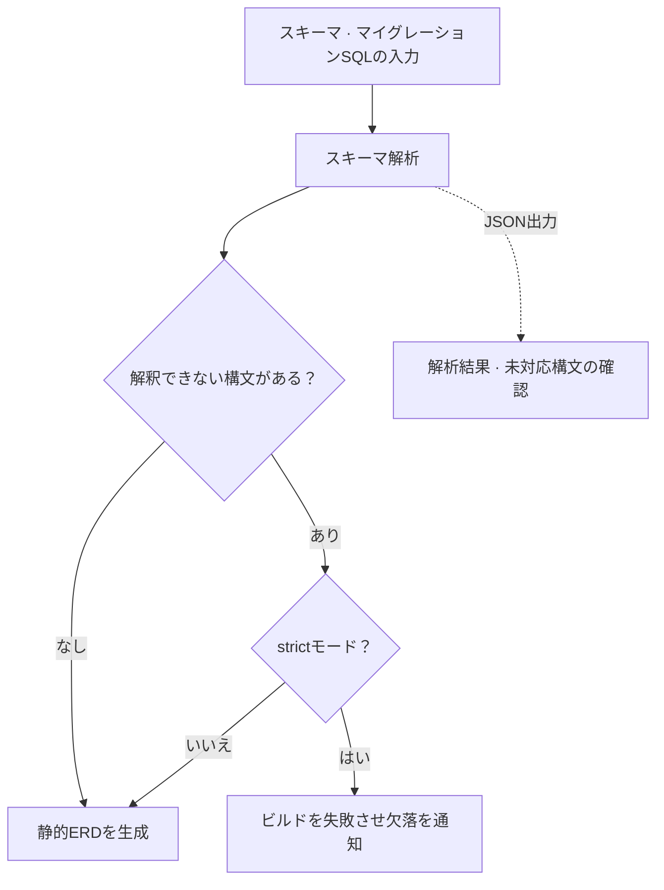

import ProjectInfo from '@/components/Project/ProjectInfo.astro';
import ImageLoader from '@/components/Blog/ImageLoader.astro';
import Mermaid from '@/components/Blog/Mermaid.astro';

<ProjectInfo frontmatter={frontmatter} />

## Intro

> **この記事はAIを活用して作成しました。**

**Crowfoot**は、データベースのスキーマファイルからERDを作り、静的Webアプリとして共有するCLIツールです。[Liam ERD](https://github.com/liam-hq/liam)を基にしたフォークで、元の図に配置保存・メモ・色・テーブルグループなどの機能を追加しました。

ERDは、テーブル同士が線でつながっているだけでは読みにくいことがあります。関連テーブルを近くに置き、ドメインごとにまとめ、関係の横に説明を添えることで構造が見えてきます。そうして整理した配置が再読み込みや再生成後も残ると、文書として使いやすくなります。

実際のプロジェクトのDB構造を文書として共有するためLiam ERDを使う中で、移動したテーブル位置が初期化されることや、キャンバスに説明を残せないことを不便に感じました。MySQL DDLへの出力も必要だったため、まずこれらを追加しました。

Crowfootは、スキーマとともに**人が整理した配置と説明を残すこと**に重点を置いています。出力は、別のバックエンドなしでHTTP配信できる静的サイトです。

### リンク

- [Crowfootデモ](https://crowfoot.jun-devlog.win/)
- [GitHub](https://github.com/Junjak-Personal/crowfoot)
- [npmパッケージ](https://www.npmjs.com/package/crowfoot)
- [使い方](https://github.com/Junjak-Personal/crowfoot/blob/master/docs/usage.md)

上部と本文の画面は公開デモから撮影しました。デモのスキーマはNiVocaのレガシー版で、現在のFlutterアプリの本番DBとは別のものです。

## 主な機能

### 開き直しても残る配置

移動したテーブルの位置をURLに含めて共有できます。配信された`layout.json`にURLの編集内容を重ねる構造で、`erd from-link`コマンドにより、リンクの変更を配置・グループ・メモのファイルへ保存できます。

これらのファイルをスキーマと一緒にバージョン管理し、生成したサイトに提供すれば、再ビルド後も配置と説明を引き継げます。位置が未設定のテーブルは自動配置を使うため、新しいテーブルが増えるたびに全体を最初から並べ直す必要はありません。

複数のテーブルやメモをまとめて選択し、移動や色の設定ができます。関連テーブルを名前付きグループにまとめると、キャンバスとサイドバーで同じ区分を確認できます。

拡大時はカラムを詳しく、縮小時はテーブル名やグループ名を中心に表示するよう、情報量も調整します。同じキャンバスで全体構造から気になるテーブルまで行き来できます。

<ImageLoader src="/images/project/crowfoot/02-table-detail.webp" alt="Crowfootのドメイン別テーブル一覧と漢字テーブルの関係詳細" width={1512} height={872} />

### 図の上に説明を残す

キャンバスにメモを置き、サイズ・色・文字サイズを調整できます。テーブルや関係線だけでは伝わらない業務ルールや設計理由を、近くに書き添えるためのものです。

配置・グループ・メモをそれぞれ`layout.json`、`groups.json`、`memos.json`に保存し、スキーマと一緒に管理できます。共有したERDは標準で閲覧モードになり、編集モードを有効にしたときだけ配置や内容を変更できます。

### ブラウザーでスキーマを編集する

編集モードでは、テーブル・カラム・制約・インデックスの修正と外部キーの接続ができます。変更対象はビューアー内で扱うスキーマであり、実際のデータベースにDDLを実行する機能ではありません。

作業結果はDDLや画像としてエクスポートできます。元の出力機能にMySQL DDLを追加し、構造を確認して別の形式に移す作業にも使えるようにしました。

<ImageLoader src="/images/project/crowfoot/03-schema-editor.webp" alt="Crowfootの編集モードでカラムと制約を修正する画面" width={1512} height={872} />

<ImageLoader src="/images/project/crowfoot/04-export.webp" alt="MySQL・PostgreSQL DDL、PNG、配置ファイルを出力するCrowfootのメニュー" width={1512} height={872} />

### CLIで生成して配置する

PostgreSQL SQLのほか、Prisma、Rails、Drizzle、tblsなどのスキーマを入力できます。簡単な生成コマンドは次のとおりです。

```sh
npx crowfoot erd build --input schema.sql --format postgres --output-dir dist
npx serve dist/
```

複数のマイグレーションSQLを順番に読み、最終的なスキーマを組み立てることにも対応しています。SQLをDBに実行する方式ではないため、動的SQLやデータ条件によって変わる変更までは再現できません。解釈できない構文を黙って飛ばさないよう、`--strict`オプションでビルドを失敗させられます。

`erd plan`と`erd arrange`は、座標を一つずつ指定する代わりに、テーブルをどのグループにまとめるかという計画から配置ファイルを作る機能です。AIエージェントもグループや説明を提案し、配置はCLIに任せられる構成にしました。

## 技術スタック

| 領域 | 使用技術 |
| --- | --- |
| ベースプロジェクト | Liam ERD, Apache-2.0 |
| ビューアー | React, TypeScript, React Flow |
| 自動配置 | ELK.js |
| UI | Radix UI, CSS Modules |
| CLI | Node.js, Commander |
| ビルド | Vite、pnpmワークスペース |
| 出力 | 静的SPA、配置・グループ・メモのJSONファイル |

## 設計と実装

### 全体構成

スキーマを読み取って成果物を作るCLIと、それを探索・編集するブラウザービューアーを分けました。成果物は静的Webアプリなので、別のバックエンドなしで共有できます。

<Mermaid title="生成ツールと静的ビューアーの構成">



</Mermaid>

| 構成要素 | 役割 |
| --- | --- |
| CLI | SQL・ORMスキーマを解析し、ERD Webアプリと関連ファイルを生成 |
| React Flowビューアー | テーブルと関係を表示し、配置・メモ・グループ・スキーマを編集 |
| 配置・グループ・メモのファイル | スキーマ本体とは別に、人が整理した図の情報を保持 |
| URL・出力経路 | 編集状態をリンクで共有し、CLIでファイルへ反映したり、DDL・画像などで出力したりする |

### スキーマ解析の抜けを明らかにする流れ

<Mermaid title="スキーマ解析の抜けを明らかにする流れ">



</Mermaid>

### スキーマを更新しても説明を残す

スキーマを作るデータと、画面上で整理した情報を分けて管理しました。スキーマを読み直しても既存テーブルの配置や説明を再適用できてこそ、図を使い捨てではなく継続して更新する文書として扱えるためです。

最近は、解析できなかった内容を明らかにすることにも力を入れました。`--json`で解析結果と未対応構文を確認し、入力ファイルのハッシュ・ツールのバージョン・ビルド時刻を成果物に残します。見栄えのよい図でもスキーマ変更が一つ黙って抜けると文書として信頼しにくいため、自動化の中で欠落を確認できるようにしたものです。

また、フォークで追加した機能と元の機能を分け、READMEとNOTICEに記載しました。CrowfootはLiam ERD全体を作り直したものではなく、既存ツールを実際に使う中で必要だった機能を加え、別の名前で配布するプロジェクトです。
