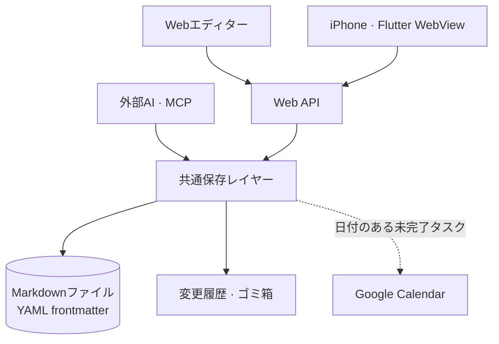
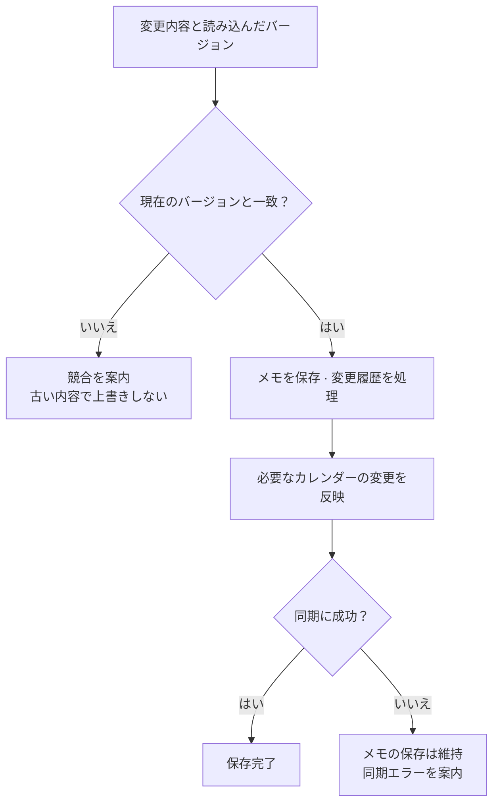

import ProjectInfo from '@/components/Project/ProjectInfo.astro';
import ImageLoader from '@/components/Blog/ImageLoader.astro';
import Mermaid from '@/components/Blog/Mermaid.astro';

<ProjectInfo frontmatter={frontmatter} />

## Intro

> **この記事はAIを活用して作成しました。**

**memo**は、自分一人で使うメモアプリです。編集はブラウザー上で行いますが、保存先はサーバーのフォルダー内にあるMarkdownファイルです。PCではWebで、iPhoneでは同じWebを開くFlutter WebViewアプリで使っています。

メモをファイルとして残しながら、スマートフォンとPCで気軽に開いて編集できることを重視しました。フォルダーで整理し、タグで探し直す機能にタスクとカレンダーを加え、記録とやることを同じ場所で扱えるようにしています。

複数人のための共同作業ツールというより、毎日使う自分のメモ帳に近いものです。複数のアカウントを作る代わりにパスワードでアクセスを保護し、保存形式には自分で読んだり移したりできるMarkdownを選びました。

### サイトリンク

- [memo](https://memo.jun-devlog.win/) — 個人用サービスで、ログイン後に利用できます。

上部と本文の画面は、現在のコードをローカルで実行し、**紹介用に作った架空のメモ**を入れて撮影しました。個人のメモは使っておらず、カレンダー画面もGoogle Calendar連携を無効にしたローカルの例です。

## 主な機能

### 画面ではエディター、保存はMarkdown

Tiptapベースのエディターで、文章・リスト・表・コードブロック・画像を編集できます。フォルダーツリーでメモを整理し、タイトルや本文の検索、タグ画面から探し直せます。

タイトル・日付・タグなどの情報はMarkdownのfrontmatterに記録します。ファイルを開くと、本文とメモの情報を一緒に確認できる構造です。削除したメモはゴミ箱から復元できます。

### 探し直し、つなぎ、繰り返し使う

最近のメモやお気に入りからよく使う文章を開き、見出しごとの目次やセクションの折りたたみで長い文書を読めます。他のメモを選ぶ内部リンクとバックリンクにも対応しています。保存時に通常のMarkdownリンクになるため、アプリの外でファイルを読むときも確認できます。

繰り返し使う文書は「マイテンプレート」に保存します。タイトル・本文・タグなどをコピーしつつ、新しいメモの日付、タスク状態、公開状態は初期化します。読書メモや旅行準備のように、形式は似ていて内容だけが変わる記録に使えます。

<ImageLoader src="/images/project/memo/04-templates.webp" alt="架空の読書メモをテンプレートとして保存し、新しいメモを作る画面" width={1512} height={872} />

### メモ・タスク・予定を区別する

メモをタスクに変えて、日付と重要度を指定できます。タスクは専用フォルダーに集め、終えた項目は完了状態で管理します。

カレンダーに表示するのは、**日付のある未完了タスク**です。通常のメモの日付は記録として残し、予定には入れません。日付があるだけですべてのメモを予定にすると、記録とやることが混ざってしまうためです。

Google Calendarには専用カレンダーを通じて一方向に連携します。メモ内でタスクの日付を変えるとカレンダーに反映し、完了したり通常のメモに戻したりすると、紐づく予定を整理します。既存のGoogleの予定をアプリに取り込む方式ではありません。

<ImageLoader src="/images/project/memo/02-todos-priority.webp" alt="架空のタスクの日付と重要度を表示するmemoの一覧" width={1512} height={872} />

<ImageLoader src="/images/project/memo/03-calendar.webp" alt="架空のタスクと期間予定を表示したmemoのローカルカレンダー" width={1512} height={872} />

### AIとつないでメモを読み書きする

MCP接続を通じ、AIクライアントからメモを検索・閲覧したり、新しいメモやタスクを作成したりできます。AIからの書き込みもWebエディターと同じ保存処理を通る構成にしました。

既存のメモを更新するときは、読み込んだバージョンを一緒に送る必要があります。その間に別の場所で変更されていれば保存を拒否し、AIが古い内容で上書きしないようにしました。削除ツールはゴミ箱への移動だけを提供します。

### 必要なメモだけを公開する

個別のメモの公開設定を有効にすると、ログインなしで読めるリンクができます。すべてのメモではなく、必要な文章一つだけを共有する仕組みです。公開するかどうかはユーザーが画面で直接決め、AIツールからは有効にできないようにしました。

## 技術スタック

| 領域 | 使用技術 |
| --- | --- |
| Webアプリ・サーバー | Nuxt 4, Vue, TypeScript, Nitro |
| UI | Nuxt UI, Tailwind CSS |
| エディター | Tiptap, Shiki |
| 保存 | Markdownファイル、YAML frontmatter |
| iPhoneアプリ | Flutter, WebView |
| カレンダー | Google Calendar API |
| AI接続 | MCP SDK, OAuth |
| デプロイ | Docker, GitHub Actions, Cloudflare Tunnel |

## 設計と実装

### 全体構成

編集画面や外部接続は複数ありますが、メモを保存するルールは一か所で管理する構成にしました。

<Mermaid title="入力は複数の場所から、保存ルールは一か所で">

</Mermaid>

| 構成要素 | 役割 |
| --- | --- |
| Nuxt Web・Flutter WebView | 同じWebエディターでメモを読み書きし、iPhoneアプリはキーボードやツールバーなどの端末動作を補う |
| Web API・MCP | 人とAIの入力を受け、共通保存レイヤーへ渡す |
| 共通保存レイヤー | Markdown・frontmatterの保存、バージョン競合の検査、変更履歴とゴミ箱の処理 |
| Google Calendar連携 | 保存済みメモのうち、日付のある未完了タスクを外部の予定に反映 |

メモのファイルはアプリの外でも読める形で残し、カレンダーはその中で予定に当たる情報を送る経路としました。メモの保存と外部同期の成否を分けたのも、この考え方によるものです。

### 既存メモの更新と外部同期の境界

<Mermaid title="既存メモの更新と外部同期の境界">

</Mermaid>

### メモを保存する経路を一つに

Webエディターからの編集でもAI経由の更新でも、ファイル保存・競合検査・ゴミ箱処理・カレンダー反映は同じ保存レイヤーを通します。入力経路が増えても、保存ルールが変わらないように意識しました。

誤って編集した内容は、変更履歴で元の文章を確認し、復元できます。自動保存のたびに履歴が無限に増えないよう5分単位にまとめ、メモごとに直近30日・最大50件を残します。

カレンダーへの反映に失敗しても、書いたメモは保存し、同期エラーは別に案内します。外部サービスの問題で、今書いた文章まで失わないための区別です。

### Webエディターをそのまま使うiPhoneアプリ

iPhoneアプリはエディターを作り直さず、Flutter WebViewでWebを開きます。編集動作はWeb側で管理し、キーボード上の編集ツールバーはネイティブで構成しました。ツールバーを押しても本文の入力フォーカスを保ち、キーボードやセーフエリア、画面復元など、実際のメモ作成に影響する部分を調整しています。

メモアプリは機能の多さより、思いついたときにすぐ書き、後から探し直せることが大事だと思います。memoもその流れを基準に、実際に使いながら必要な機能を少しずつ加えています。
