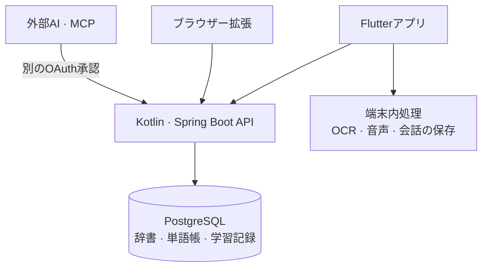
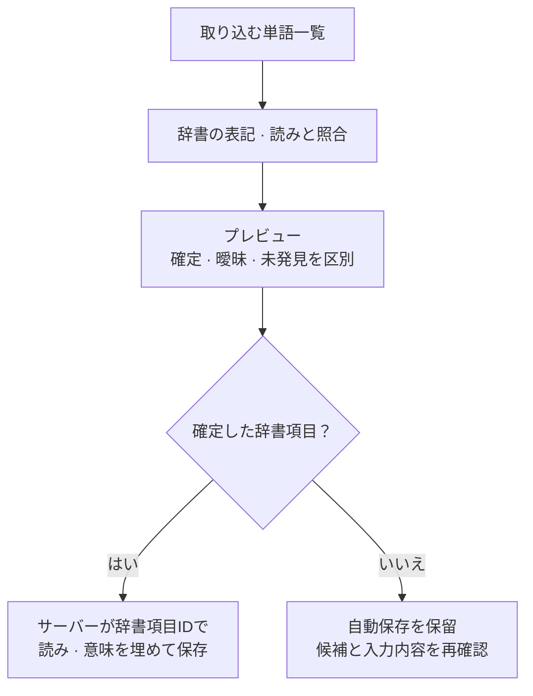

import ProjectInfo from '@/components/Project/ProjectInfo.astro';
import ImageLoader from '@/components/Blog/ImageLoader.astro';
import Mermaid from '@/components/Blog/Mermaid.astro';

<ProjectInfo frontmatter={frontmatter} />

## Intro

> **この記事はAIを活用して作成しました。**

**NiVoca**は日本語の単語を集めて復習するアプリです。以前紹介した[NiVoca (Legacy)](/project/nivoca-legacy)をFlutterとKotlin/Spring Bootで作り直し、現在はこの版をApp Storeで運用しています。

最初の目的は、日本語の単語を少し楽に入力することでした。韓国語・英語のキーボードから日本語の単語一つのために切り替えるのが面倒で、ローマ字をかなに変換する単語帳から始めました。そこへ本や画面の単語を写真から取り込み、保存した単語を取り出して学ぶ機能を一つずつ加えました。

以前の版では、オンデバイスAIのように端末機能を直接扱うことも試しました。WebとWebView中心の構造につなぎ足す限界を感じ、アプリをFlutterへ移し、バックエンドも別に構成しました。単語入力から学習まで、モバイルアプリの中で自然につながる方向へ作り直したプロジェクトです。

## プロジェクトの画面

<figure>
<ImageLoader src="/images/project/nivoca/01-word-add.webp" alt="辞書検索から読み方と意味を入力したNiVocaの単語追加画面" width={960} height={1937} />
<figcaption>辞書で見つけた単語を、意味・読み方と一緒に追加します。</figcaption>
</figure>
<figure>
<ImageLoader src="/images/project/nivoca/02-ocr-results.webp" alt="NiVocaの写真認識で見つかった日本語の単語候補を選ぶ画面" width={960} height={2081} />
<figcaption>写真から読み取った単語のうち、必要なものだけを選んで保存します。</figcaption>
</figure>
<figure>
<ImageLoader src="/images/project/nivoca/03-wordbooks.webp" alt="NiVocaのテーマ別マイ単語帳一覧" width={960} height={1937} />
<figcaption>学ぶテーマごとに単語帳を分けます。</figcaption>
</figure>
<figure>
<ImageLoader src="/images/project/nivoca/04-quiz.webp" alt="NiVocaの単語カードで例文を見て復習の難易度を評価する画面" width={960} height={1937} />
<figcaption>単語と例文を確認し、復習の難易度を評価します。</figcaption>
</figure>
<figure>
<ImageLoader src="/images/project/nivoca/05-writing.webp" alt="NiVocaの漢字の書き順ガイドに沿って手書きする練習画面" width={960} height={1937} />
<figcaption>書き順ガイドを見ながら、実際に書いてみます。</figcaption>
</figure>

Flutterアプリの辞書検索後の単語追加、写真認識結果、単語帳、クイズ、書き取り練習の画面です。2026年8月頃に実機で撮影した資料で、現在の配信版とは一部のUIが異なる場合があります。

### リンク

- [App StoreでNiVocaを見る](https://apps.apple.com/kr/app/nivoca/id6769042671)
- [NiVoca紹介サイト](https://nivoca-landing.jun-devlog.win/)
- [ブラウザー拡張ガイド](https://nivoca-landing.jun-devlog.win/guide/extension/)
- [以前のWeb・React Native版の紹介](/project/nivoca-legacy)

## 主な機能

### 単語を集めるさまざまな方法

辞書で直接検索したり、写真やコピーした日本語の文章から単語を探して単語帳へ追加したりできます。ローマ字のほか、音声・手書き入力にも対応しています。保存時に読み方と意味を確認し、単語帳とタグで学ぶ内容を分けられます。

他のアプリで見ていた日本語を共有シートやクリップボードから取り込む経路もあります。写真のOCRにはiOSのApple VisionとAndroidのML Kitを使い、認識した文章から単語候補を選ぶ段階とは分けています。

自分で単語帳を埋める以外に、JLPTレベル別や共有単語帳を使う方法もあります。単語詳細では例文と漢字の情報も確認でき、意味だけを覚えて終わらないようにしました。

### 単語帳を共有し、購読・コピーする

自分で整理した単語帳を公開し、他の人の単語帳を購読したりコピーしたりできます。JLPTレベル別の基本単語帳のほか、旅行・食べ物・読んでいる文章など、同じテーマの単語をまとめて渡す用途です。共有単語帳を確認して必要なものを選べるため、最初からすべての単語を入力しなくても学習を始められます。

購読した単語を自分の単語帳に入れる機能もあります。共有の停止やユーザーのブロック後に共有単語が表示され続けないようアクセス範囲を管理し、現在クイズに使えない単語帳には理由を案内します。アプリ外から単語を取り込む共有メニューと、アプリ内で単語帳を分け合う共有は、別の流れにしています。

購読は元の単語を読む関係で、コピーはアクセス可能な単語を自分の所有として取り込み、新しい単語帳に結び付ける操作です。元の公開状態に従う購読と独立した自分の単語を区別する必要があるため、同じ「追加」処理にはまとめませんでした。AIの回答をコピー・共有する機能も別に用意しています。

一覧にした単語はCSV・TSVなどのテキストファイルとしてAI会話に添付できます。ファイルを読む段階と実際の単語保存を分け、提案を確認してから反映します。オーナー向けMCPでも、外部AIがCSVを解釈し、取り込みのプレビューと適用ツールを呼ぶ経路を用意しました。

### 集めた単語をもう一度学ぶ

復習にはFSRSの間隔反復アルゴリズムを使います。クイズ後に難易度を評価すると、単語ごとの復習間隔が調整されます。単語カード、例文の穴埋め、意味を見て書くなど、さまざまな方法で記憶を確認できます。

アプリを開き直しても、その日のクイズとクイズ中のAI会話を続けられます。ひらがな・カタカナや文法の基礎学習、書き順に沿った練習、音声で発音を確かめる機能もあります。

最近は単語・意味・例文を順番に読み上げるリスニングモードも追加しました。他のアプリの使用中や画面を消した状態でも再生でき、繰り返し回数・速度・読み上げ間隔を調整できます。韓国語の意味を読む音声パックは、一度ダウンロードすると端末内で動きます。

### AIアシスタント

初期のFlutter版では端末内で動くモデルを実験しましたが、現在の配信版のAIアシスタントは**ユーザー自身のOpenAIまたはAnthropic（Claude）のAPIキー**で動きます。設定で提供元を選び、送信に同意してから使い、API料金はそのキーのアカウントへ請求されます。

日本語について質問したり、単語の追加・修正、単語帳の整理を依頼したりできます。データを変更する依頼は、先に変更内容を表示し、ユーザーの確認後に実行します。会話は基本的に端末へ保存し、手動でバックアップを依頼したときにサーバーへ最新のコピーを保管します。現在の提供方法は[App Storeの説明と更新履歴](https://apps.apple.com/kr/app/nivoca/id6769042671)でも確認できます。

画像・PDF・テキストファイルを添付して質問したり、複数の単語をまとめて探して整理したりできます。写真の文字を読むOCRの端末内処理と、質問・添付資料を選んだAI提供元へ送る経路は別です。

<figure>
<ImageLoader src="/images/project/nivoca/ai-photo-words.webp" alt="NiVoca AIに旅行中の案内文の写真を添付し、単語追加を依頼した実際のiPhone画面" width={960} height={2081} />
<figcaption>写真の単語を選ぶよう依頼した実際のアプリ画面です。AIは登録待ち一覧を作り、保存前に承認が必要と案内します。</figcaption>
</figure>
<figure>
<ImageLoader src="/images/project/nivoca/quiz-summary.webp" alt="NiVocaの実際のiPhoneアプリのクイズ結果と、リスニング・AI質問への入口" width={960} height={2081} />
<figcaption>自分で撮影したクイズ結果の画面です。復習したカード・新しいカード・回答スコアを確認し、リスニングやAIへの質問へ進めます。</figcaption>
</figure>

## MCPで外部AIとつなぐ

アプリ内のAIチャットに加え、普段使うAIツールからNiVocaの単語や学習記録を扱うMCP接続も作りました。例えば「最近のクイズで間違えた単語を集めて説明して」と頼んだり、整理した単語一覧を新しい単語帳へ入れたりする流れです。**現在は開発者本人のアカウントだけに限定した運用機能**で、全ユーザーに公開した機能ではありません。

サーバーのMCPアドレスは`https://n-api.jun-devlog.win/mcp`です。外部クライアントがOAuth承認を要求すると、NiVocaアカウントでログインしてアクセスを許可します。アプリのログイントークンとMCPトークンは分け、接続一覧から特定の接続を切ると、そのアクセスも止めます。更新トークンは使用時に入れ替え、交換済みトークンが再利用された場合は接続を取り消します。

現在は13のツールがあり、大きく次の作業に分かれます。

| 作業 | 活用例 |
| --- | --- |
| クイズ履歴・誤答の取得 | 学習日と問題の記録を読み、よく間違える表現を改めて説明する |
| 自分の単語・単語帳の取得 | 集めた単語や単語帳を検索し、学習範囲を決める |
| 辞書の一括検索 | 複数単語の読み方と意味をまとめて確認する |
| 単語追加・単語帳作成 | 確認済みの辞書項目を単語帳へ入れる |
| 取り込みのプレビュー・適用 | 確定・曖昧・未発見を先に分け、確定した項目だけを保存する |
| 未収録単語のリクエスト | 辞書にない単語をコンテンツ補完の経路へ渡す |

単語追加時にはAIが送った意味をそのまま保存せず、**サーバーが辞書項目IDを基に読み方と意味を埋めます。** 候補が複数ある単語は取り込み段階で曖昧な項目として残します。プレビューと適用を分けたのも、AIが推測した値を直接単語帳へ書き込まないためです。

Claude Codeから本番サーバーへ実際に接続し、クイズ履歴と誤答を取得した記録があります。他のクライアントの接続や書き込み操作は確認範囲が異なるため、すべて検証済みとして紹介しません。アプリ内のBYOKアシスタントとMCPは役割も異なり、前者はアプリからAI提供元を呼び、後者は外部AIからNiVocaの限られたツールを呼びます。

誤答取得でも、評価だけから推測せず、その問題の正解・選んだ選択肢・書き取り認識結果を一緒に扱います。初期には書き取りの誤答が「難しい」として保存され、通常の誤答集計から漏れる問題がありましたが、保存した正誤結果で区別するよう修正しました。判定情報のない過去の記録は判定不明のまま残します。

## Safariで読みながら単語を集める

### ページ内で検索し、読み仮名を付ける

別途開発した**Safari Web Extension**は、閲覧中のページで日本語を選び、意味と読み仮名を確認する機能です。アプリのSafari拡張ターゲットを共通のブラウザー拡張ソースにつなぎ、デスクトップのChrome系でも同じソースを使います。従来の共有メニュー拡張とは別です。

ページごとに手動で有効にするほか、アクセスを許可したサイトでは自動使用を設定できます。本文に読み仮名を付ける場合は表示する難易度を選び、「現在の画面に適用」を押します。入力欄やコードなど変更すべきでない領域を除き、現在見えている本文の一部だけに適用範囲を限定しました。

NiVocaアカウントと拡張を接続するときは、アプリで接続コードとアカウントを確認して承認します。Google・Appleで登録したアカウントも、新しいパスワードを作らずに使える流れです。選択検索で送る文章と、本文への読み仮名適用で送る文章の範囲も区別します。ページ全体をバックグラウンドで自動収集する、と説明すると実際の動作とは異なります。

SafariはNative Messagingでネイティブブリッジを通り、接続状態とセッションをKeychainで管理します。ページのJavaScriptへアプリの認証Cookieは渡さず、ブリッジが要求できるサーバーとパスも制限します。Chrome系のサービスワーカーによる送信とUIソースは共有しつつ、ブラウザーごとの認証・通信の境界は分けました。

<figure>
<ImageLoader src="/images/project/nivoca/safari-reader.webp" alt="iPhone Safariで選択した日本語の意味と読み方を表示するNiVoca拡張のカード" width={960} height={2081} />
<figcaption>閲覧中のページで「以下」を選び、意味・読み方を確認して単語帳へ追加する実際の画面です。</figcaption>
</figure>
<figure>
<ImageLoader src="/images/project/nivoca/safari-settings.webp" alt="NiVoca Safari拡張の自動使用と読み仮名の難易度設定" width={960} height={2081} />
<figcaption>Webサイトでの自動使用と、読み仮名を表示する範囲を設定します。</figcaption>
</figure>

上の画像は、開発中の拡張を端末にインストールして確認したデバッグキャプチャです。公開iOSアプリの機能一覧とは区別する必要があります。インストール・アカウント接続・検索・送信範囲の流れは[ブラウザー拡張ガイド](https://nivoca-landing.jun-devlog.win/guide/extension/)にもまとめました。

### 他のアプリの共有メニューから取り込む

従来のiOS共有・Action拡張は、選択したテキストや写真をNiVocaへ渡します。単語一つなら辞書検索、長い日本語なら単語候補の抽出、写真なら画像認識へ進むよう入口を分けました。Safari内の読書を助けるWeb Extensionとは異なり、他のアプリで見つけた内容を単語帳アプリへ取り込む役割です。

## 学習の達成感をつなぐゲーム、Mate — 開発中

単語を覚えた成果が復習統計だけでなくキャラクターの成長につながるよう、**Mate**というゲーム機能も開発しています。勉強を続ける動機を作る試みであり、現在App Storeで提供している完成済みのゲームではありません。

初期のペット構想から、人型キャラクターを育てて着せ替える方向へ発展しました。学習で経験値と成長資源を得て、それを基に探索し、装備やカードを集める流れを作っています。勉強の代わりになるミニゲームより、学習の成果で次の探索を準備する構造です。

探索では戦闘・ショップ・未知のイベントなどの部屋を選び、戦闘では手札の順序と組み合わせを決めて行動します。カードのコストや敵の次の行動を見てコンボを準備するため、キャラクターを入手するだけでなく、育てた後の使い道も作っています。

戦闘はカードとサイコロの目を組み合わせる構造です。カードを置くマスの目で効果が変わり、防御・印・呪文・フィニッシャーをどの順に並べるか決めます。実行前に予想ダメージと敵の攻撃が割り込む位置を確認し、コンボを確定すると結果を再生します。長期学習で得る成長と、一度の探索で作る戦闘の組み合わせを分け、長く勉強した数値だけですべての戦闘が決まらないよう調整しています。

<figure>
<ImageLoader src="/images/project/nivoca/mate-home-development.webp" alt="開発中のNiVoca Mateのキャラクターと学習経験値・成長ステータスの画面" width={780} height={1688} />
<figcaption>学習経験値と成長ステータスを表示した、開発用の固定データによるレンダーです。</figcaption>
</figure>
<figure>
<ImageLoader src="/images/project/nivoca/mate-battle-iphone.webp" alt="開発中のNiVoca Mateの月の遺跡での戦闘とコンボ準備を直接撮影した画面" width={960} height={2081} />
<figcaption>追加のデバッグ資料から選んだ、実際のiPhoneの戦闘画面です。</figcaption>
</figure>
<figure>
<ImageLoader src="/images/project/nivoca/mate-route-iphone.webp" alt="開発中のNiVoca Mateの探索経路と部屋選択マップを直接撮影した画面" width={960} height={2081} />
<figcaption>訪れた部屋と次の経路を確認する、開発アプリの探索マップです。</figcaption>
</figure>

最初の画像は固定の例示データでレンダーし、残り2枚は開発アプリを直接撮影しました。撮影時の正確なビルドは未確認で、画面の数値やバランスもリリース仕様ではありません。実際のFlutter画面とピクセルアート素材を合わせながら、キャラクター・戦闘・探索の画面を調整している段階です。

実装は`mate_feature`というFlutterの機能パッケージに分けました。キャラクターの場面にはFlameを、画面と戦闘UIにはFlutterウィジェットとCustomPainterを使います。探索の進行と報酬はサーバーが判定し、学習完了リクエストには固定した学習一覧とリクエスト識別子を使い、再試行による二重報酬を防ぎます。リスニングの中断やTTSエラーによる終了と、正常な完走も区別します。

2026年11月4日時点で、stageへの反映とテストアプリのインストール・起動の記録があります。ただし、探索全体の実機プレイ、面白さやバランスの確認、最終的な成長方針は引き続き検討中で、App Store公開とは別です。

## データセットをどう集めたか

単語帳のUIを作ることと、学習に使える辞書・意味・例文を埋めることは別の作業でした。NiVocaは、**外部公開データを基にした基本辞書**、**AIで翻訳・補完した内容**、**自分で作成・確認した内容**を組み合わせています。すべて一から自作した辞書、あるいはすべてAI生成のデータと紹介するのは、どちらも実態と異なります。

| 資料 | 入手経路とアプリでの利用内容 |
| --- | --- |
| 日本語辞書 | [JMdict/EDRDG](https://www.edrdg.org/wiki/JMdict-EDICT_Dictionary_Project.html)のデータを[jmdict-simplified](https://github.com/scriptin/jmdict-simplified)のJSON形式で取り込み、表記・読み・品詞・意味を構成 |
| 検索時の補完 | Jishoの検索結果を確認・キャッシュし、同じ単語でも表記と読みが一致する候補かを検証 |
| JLPT基本単語帳 | Tanos由来のJLPT一覧を取り込み、レベル別の基本単語と単語帳を構成 |
| 漢字 | [KANJIDIC2/EDRDG](https://www.edrdg.org/wiki/KANJIDIC_Project.html)を基に、音読み・訓読み・画数などを構成 |
| 書き順 | [KanjiVG](https://kanjivg.tagaini.net/)のSVGと筆順を、かな・漢字のガイドと書き取り練習に利用 |
| 文法 | [Hanabiraの公開日本語コンテンツ](https://github.com/tristcoil/hanabira.org-japanese-content)を基に文法項目を整理し、韓国語の説明を補完 |
| 日本史・文化の語彙 | Jisho/JMdictと日本語Wikipediaで表記・読みの根拠を照合し、テーマ別に選定 |
| 韓国語の意味・例文 | 元データの意味を翻訳・補完し、学習用例文をAI生成したうえで、自作資料と確認・訂正も反映 |

### 取り込んだ後も正規化と補完が必要だった

辞書から単語を一つ取り込んでも、そのまま学習カードが完成するわけではありません。同じ表記の異なる読みを区別し、品詞やJLPTレベルを合わせ、韓国語の意味と例文を埋める必要があります。複数の読みや意味を一つにまとめると、検索は楽でも学習データが不正確になり得ます。

既存の辞書項目は再利用し、不足する内容を別のコンテンツ生成・補完経路で埋めます。AI生成の内容も元資料と区別して追跡します。テーマ別単語帳でも、まず単語一覧と辞書項目を照合し、新しい項目が必要な場合だけ補完します。

検索はまずDBの既存項目を確認し、必要に応じてJishoで表記・読みの完全一致を探してからAI補完へ進みます。外部応答待ちの間にDBロックや接続を保持し続けないよう、ネットワーク呼び出しと保存トランザクションも分けました。

例文を埋める経路も一つではありません。エージェントが空欄を埋めるルーチン、Claude APIによる大量バッチ、サーバーの非同期自動補完を別々に運用し、出典を残します。自動補完は埋まった内容を上書きせず、作業の重複・予算・再試行条件を確認します。報告を受けて既存内容を直す訂正作業は、これらの追加用経路とは区別しています。

### 例文とテーマ別単語帳を継続して補う

2026年11月1日の作業記録には、新規例文11,630行と既存例文の修正2,138行を反映した記録があります。11月2日には、日本史725語、日本文化255語の単語帳を追加しました。この数値はその作業の記録であり、辞書全体の現在の規模を示すものではありません。

AIで大量に生成できても、そのまま正確な教材になるわけではありませんでした。例文の日本語と訳が合っているか、単語の読みや用法が自然かを確認し、誤りは報告と別途の訂正作業で修正し続けています。

例文バッチには意味・品詞・同形異義語の情報も渡し、確信のない項目は飛ばすようにしました。生成後は見出し語の有無、読みに使う文字、翻訳、重複、長さを検査します。既存例文の訂正は、誤りの候補を見つける段階と再確認の段階を分けました。「心中」のように同じ表記でも読みや意味が異なる語は、文そのものがその意味に合うかも確認する必要がありました。

### アプリ内でデータの出典を確認する

外部データとコードライブラリの出典は別々に管理します。アプリの「設定 → 情報 → データ出典」に、辞書・漢字・JLPT・文法の原本と利用条件を表示しました。公開リポジトリの資料でも、コードとコンテンツの条件が同じとは考えず、データごとに出典を分けて記録しています。

## 設計

アプリ・ブラウザー拡張・外部AIで同じ単語と学習データを扱いますが、端末機能とデータ変更権限は各経路の役割に合わせて分けました。

<Mermaid title="アプリ・サーバー・外部接続の役割">

</Mermaid>

| 構成要素 | 役割 | 処理・保存の基準 |
| --- | --- | --- |
| Flutterアプリ | 単語入力・復習画面、OCR・音声などの端末機能 | OCRとダウンロードした音声モデルは端末で実行し、AI会話は基本的に端末へ保存 |
| Kotlin・Spring Bootサーバー | 辞書検索、単語帳・学習記録の管理 | 単語と学習記録をPostgreSQLに保存し、登録時に辞書項目から読みと意味を確定 |
| ブラウザー拡張 | 閲覧中のページで単語を検索・追加 | 共通UIを共有しつつ、SafariのネイティブブリッジとChromiumの認証・送信経路を分離 |
| MCP接続 | 外部AIクライアントからの取得・変更依頼 | アプリログインとは別のOAuthトークンを使い、取り込みプレビューと保存を区別 |

処理場所は、端末ですぐ行う機能か、複数の入口で同じ基準を適用すべきデータかを分けて決めました。写真の文字認識や音声再生はアプリ側に置き、辞書項目と学習記録の一貫性はサーバーで管理します。

AIの提案もこの区分に従います。単語を探す・整理する提案と実際のデータ変更を分け、外部サービスを待つ作業とDB保存トランザクションも分けました。アプリ・拡張・AI接続が増えても、保存される学習データの基準が変わらない設計です。

### AIで単語一覧を取り込む流れ

<Mermaid title="AIで単語一覧を取り込む流れ">

</Mermaid>

## 技術スタック

| 領域 | 使用技術 |
| --- | --- |
| モバイルアプリ | Flutter, Dart |
| アプリ構成 | MVVM, Repository, Riverpod, go_router |
| UI | ThemeData・ThemeExtensionベースの独自テーマ、Widgetbook |
| バックエンド | Kotlin, Spring Boot, PostgreSQL |
| 復習 | FSRS間隔反復 |
| MCP | MCP Java SDK, Streamable HTTP, OAuth·PKCE |
| ブラウザー拡張 | TypeScript共通ソース、Safari Web Extension・Native Messaging、Chromium Manifest V3 |
| 開発中のゲーム | Flutter機能パッケージ、Flame、CustomPainter、Kotlinの探索・戦闘エンジン |
| OCR・音声 | Apple Vision・ML Kit、OS TTS・VOICEVOX・Supertonic、Dart FFI |
| 紹介サイト | Astro |
| サーバー運用 | Docker, GitHub Actions, Cloudflare Tunnel |

Flutter UIはWebのコンポーネントライブラリをそのまま置き換えるのではなく、ThemeDataとThemeExtensionの上でアプリの色・文字組み・コンポーネントを合わせる形にしました。共通UIはWidgetbookで別途確認します。

アプリ・バックエンド・紹介サイトはそれぞれのリポジトリで管理し、モノレポでサブモジュールとして接続します。アプリ画面だけの変更と、辞書・学習データを扱うサーバー作業を区別して運用しています。

## 運用する中で

単語帳アプリでは、機能追加と同じくらい辞書や問題の正確さを保つことが重要でした。意味や例文が不自然だと学習に影響し、穴埋めの誤答選択肢が正解に似ていると、解いてもすっきりしません。

### 正解が二つに見える問題を減らす

穴埋めでは、正解と同じ意味分野の単語が誤答選択肢に混ざらないよう調整しました。適切な選択肢を十分作れなければ、無理に選択問題を出さず単語カードへ切り替えます。単語を学習対象から外さず、出題しにくい形式だけを変える選択です。

### 端末機能とサーバーデータを分けて扱う

OCRとダウンロードした音声モデルは端末で動きますが、単語と学習記録はサーバーに保存し、AIへの質問は選んだ提供元へ送ります。機能ごとに処理場所や保存期間が違うため、アプリ全体を完全なオフラインサービスとは扱っていません。会話のローカル保存と手動バックアップも、この区分に沿って設計しました。

音声は、日本語のOS TTS・VOICEVOXと韓国語のOS音声・Supertonicを目的に応じて使い分けます。韓国語音声パックの追加時は、ONNXランタイムをもう一つ入れず、既存のVOICEVOX側ランタイムのC APIをDart FFIで再利用して重複を減らしました。

### 保存応答が途切れても復習を二重処理しない

後続の開発版では、復習リクエストに安定した識別子を付け、送信結果を確認できないものをアカウント別の待機一覧へ残します。再試行時は別の復習を作らず元のリクエストを確認し、FSRSの状態が二度進まないようにします。誤って押した評価の訂正経路も分けました。この変更は、公開iOS 1.7.0とは別の後続実装です。

### 誤りを直せる経路を残す

単語詳細だけでなく、辞書検索結果・クイズの正解確認・漢字情報からも誤りを報告できます。意味・例文・訓音・読み仮名など誤った箇所を区別して受け取り、確認した内容だけを訂正します。生成モデルを変えるだけで既存データまで自動で正確になるわけではないため、保存済みの内容を見直す作業も引き続き必要でした。

最初は単語入力を楽にするために始めましたが、今は単語に出会った瞬間から集め、共有し、もう一度学ぶまでの全過程を、自分で使いながら磨くプロジェクトになりました。
