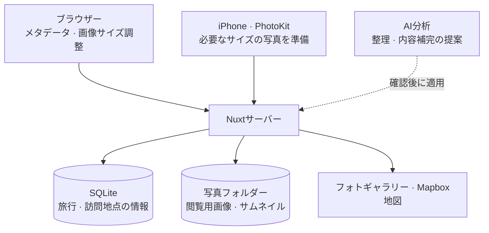
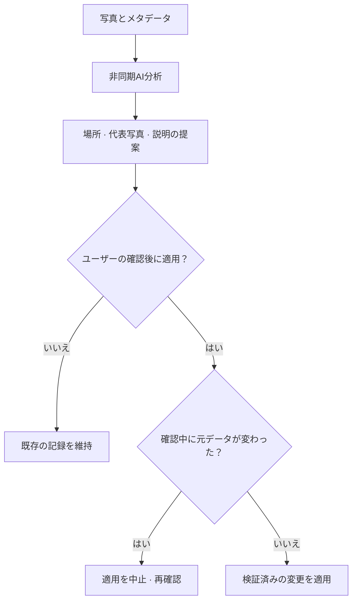

import ProjectInfo from '@/components/Project/ProjectInfo.astro';
import ImageLoader from '@/components/Blog/ImageLoader.astro';
import Mermaid from '@/components/Blog/Mermaid.astro';

<ProjectInfo frontmatter={frontmatter} />

## Intro

> **この記事はAIを活用して作成しました。**

**pic·blog**は、写真と地図、短い文章を一緒に残す個人の旅行記録です。写真のEXIFにあるGPS座標と撮影時刻から訪問地点と移動経路を作り、そこに場所の名前や文章を添えられます。

旅の写真を時系列で見れば何を見たかは分かりますが、どこで撮ってどんな順番で回ったかは別に思い出す必要があります。pic·blogは、写真にすでに入っている情報を使って旅を振り返れるようにしました。

長い文章を書く前に写真をアップロードして記録の骨組みを作り、後から物語を加える方式です。閲覧者は公開リンクから直接入り、編集だけをパスワードで保護します。複数ユーザーのアカウントを管理するサービスより、自分の旅を記録して共有するために必要な範囲に絞りました。

### サイトリンク

- [pic·blog](https://pic-blog.jun-devlog.win/)
- [GitHub](https://github.com/Junjak-Personal/pic-blog)

上部と本文の画面は、実際に運用中の公開旅行記録から撮影しました。モバイル画面はWebのレスポンシブ表示です。

## 主な機能

### 写真から訪問地点を作る

ブラウザーで写真の位置と撮影時刻を読み、距離・撮影順・旅行の日数・時間の空きを合わせて地点を作ります。同じ場所でも、別の日や長い時間を空けて再訪した場合を区別します。地点ごとに名前・タグ・本文を付けて、旅の一場面として整理できます。

一度決まった地点の座標は、写真を追加しても自動では動きません。まとめ直す場合は編集画面で半径を変更します。その過程で既存の説明が消える場合は、対象を先に表示して確認を求めます。

### 撮影順につながる地図

地図では写真を撮った順番に座標をつなぎ、移動経路を表示します。場所ごとの代表座標だけを結ぶと、その場所の中で動いた記録が消えるため、経路と距離の計算には個々の写真の座標を使います。

撮影時刻が分からない写真は経路から除外します。表示する距離も写真間の座標を結んだ値で、道路に沿った移動距離や連続したGPS記録とは異なります。写真に残った旅の流れを見るためのものです。

<ImageLoader src="/images/project/pic-blog/02-route-desktop.webp" alt="静岡・伊豆旅行の日別写真地点と撮影順の移動経路" width={1272} height={874} />

### モバイルで記録し、リンクで共有する

スマートフォンで写真を選び、場所ごとの内容を編集できます。訪問者はログインせずに写真と地図を一緒に閲覧でき、PWAとしてホーム画面に追加して使うこともできます。

画面は写真が先に目に入る構成にし、地図と文章が横で文脈を補うようにしました。写真のアップロードから旅を楽しむところまで、小さな画面でも自然につながるよう意識しています。

<ImageLoader src="/images/project/pic-blog/03-point-story-desktop.webp" alt="訪問地点を選ぶと、写真と物語が地図と一緒に開く画面" width={1272} height={874} />

<ImageLoader src="/images/project/pic-blog/05-point-mobile.webp" alt="スマートフォンの幅で見る場所の説明と旅行写真" width={390} height={844} class="mx-auto max-w-sm" />

### AIで写真を整理し、記録を補う

最近、写真とメタデータを分析するClaudeベースの機能を追加しました。写真をまとめ直してタイトルを提案する整理モードと、既存の地点を保ちながら代表写真・短い説明・地名候補を提案する補完モードがあります。上の場所詳細画面の説明も、実際の補完結果です。

提案は確認してから適用します。地名は根拠となる写真付きの候補として残し、既存のタイトルを自動で上書きしません。ユーザーが書いた文章や写真の所属を守り、確認中に元データが変わっていれば適用を止めます。適用時の状態が維持されている場合は、元に戻すこともできます。

写真が多い場合は、最大1,000枚を複数のリクエストに分けて非同期で分析します。AIが返した写真IDと地点IDをサーバーで検査し、写真の欠落や重複を確認します。

MCPも接続し、外部のAIクライアントから旅行記録を読んだり、限られた項目を更新したりできます。Web編集用のパスワードとは別に、OAuthの承認を通る経路です。

## 技術スタック

| 領域 | 使用技術 |
| --- | --- |
| フレームワーク | Nuxt 4, Vue, TypeScript |
| UI | Reka UI、CSSトークン、scoped CSS |
| 地図 | Mapbox GL JS |
| 写真のメタデータ | exifr |
| iPhoneアプリ | Flutter WebView、PhotoKit連携 |
| 保存 | SQLite、better-sqlite3、ローカルファイル |
| 認証 | nuxt-auth-utils、パスワードによる編集権限 |
| 写真AI・外部接続 | Anthropic Claude, MCP, OAuth |
| 検証 | Vitest, Playwright |
| デプロイ | Docker, GitHub Actions, Cloudflare Tunnel |

## 設計と実装

### 全体構成

写真の準備、旅行記録の保存、記録を楽しむ画面を分けました。個人サーバーが重い画像変換まで担わずに済むよう、アップロード前の準備はクライアントが担当します。

<Mermaid title="写真の準備・保存・閲覧画面の構成">

</Mermaid>

| 構成要素 | 役割 |
| --- | --- |
| ブラウザー・iPhoneアプリ | 写真の選択、メタデータの確認、アップロード画像の準備。iPhoneはPhotoKitで必要なサイズの写真を取得 |
| Nuxtサーバー | 旅行・訪問地点の情報をSQLiteに保存し、処理済み写真をファイルで保管 |
| 地図・ギャラリー | GPS座標と撮影順を基に、場所・写真・移動の流れを一緒に表示 |
| AI分析経路 | 写真整理・内容補完を非同期で提案し、確認と検証を経て変更を適用 |

保存構成はSQLiteと写真フォルダーだけで運用できるほど小さく保ちました。AI分析も既存記録を直接上書きする経路にはせず、提案と適用の間に確認段階を置き、自分で整理した旅行記録を守るようにしました。

### AIの提案を旅行記録に反映する流れ

<Mermaid title="AIの提案を旅行記録に反映する流れ">

</Mermaid>

### 画像処理はブラウザーで

Webでは写真をブラウザーでリサイズしてからサーバーに送ります。長辺最大2,048pxの閲覧用画像と400pxのサムネイルを作り、サーバーには原本を別途保存しません。

複数枚のアップロードも、一枚ずつ処理してメモリーを解放する流れにしました。サーバーが画像変換を担う必要がなく、受け取った写真をファイルとして保存する単純な構造を保てます。

iPhone向けにはFlutter WebViewアプリも作りました。iOSのWeb写真選択で大きな画像の変換を待つ問題を減らすため、PhotoKitと接続しています。必要なメタデータだけを読み、必要なサイズで画像を取得してWebのアップロード処理に渡します。写真をまとめるルールと編集ロジックはWebと共通です。

### 小さなサーバーで管理しやすい構成

データはSQLiteファイルに、写真はサーバーのフォルダーに保存します。外部DBやオブジェクトストレージを別途置かず、アプリのプロセスとデータフォルダーを管理する構成です。

個人の旅行記録という規模に合わせ、運用する構成要素を減らしました。その代わり、コンテナを入れ替えてもDBと写真が残るよう、データディレクトリを分離しています。

pic·blogは、写真を選んでアップロードするだけで記録を始められるプロジェクトです。地図上で当時の写真を見つけ直し、必要な物語を加えて旅を整理することに重点を置いています。
